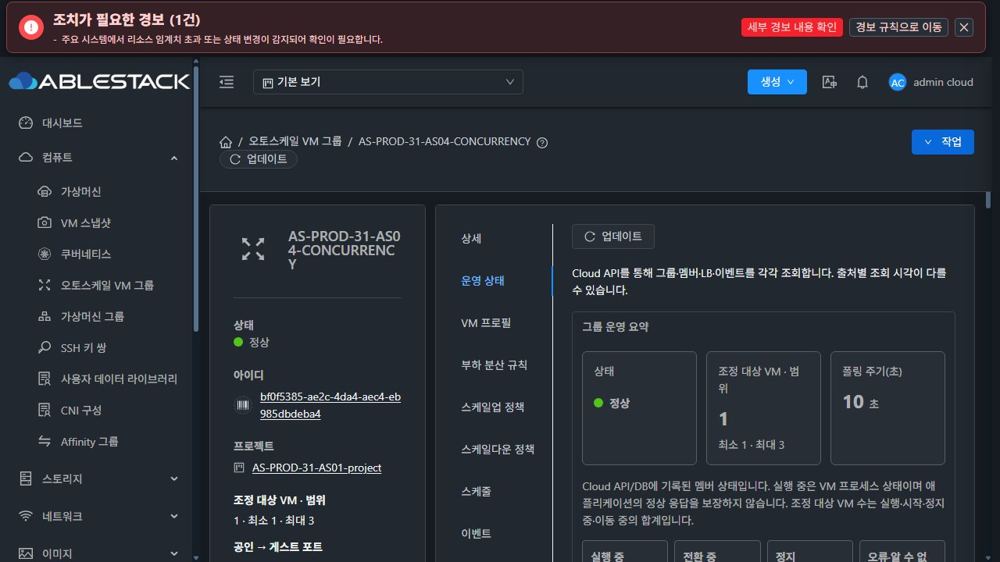
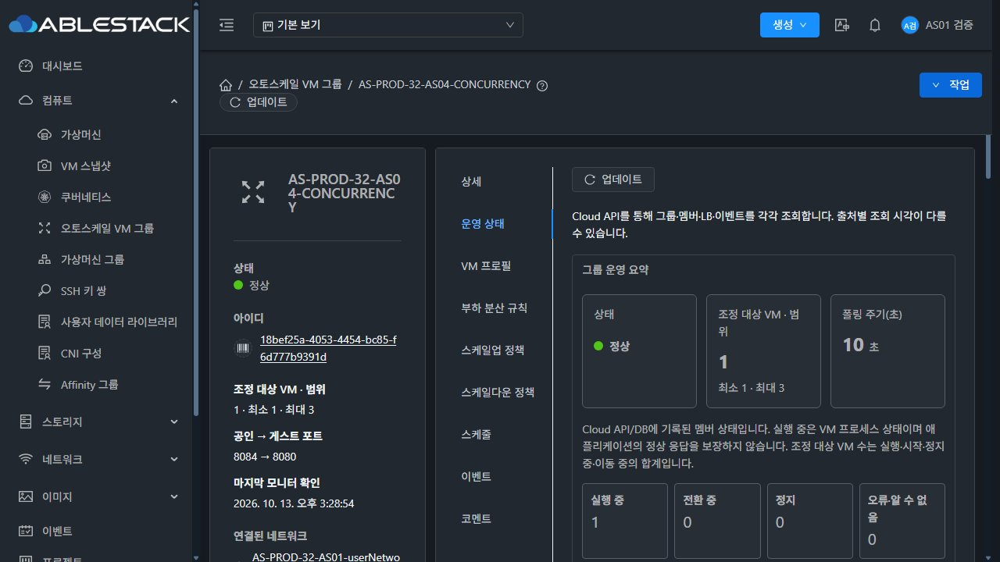
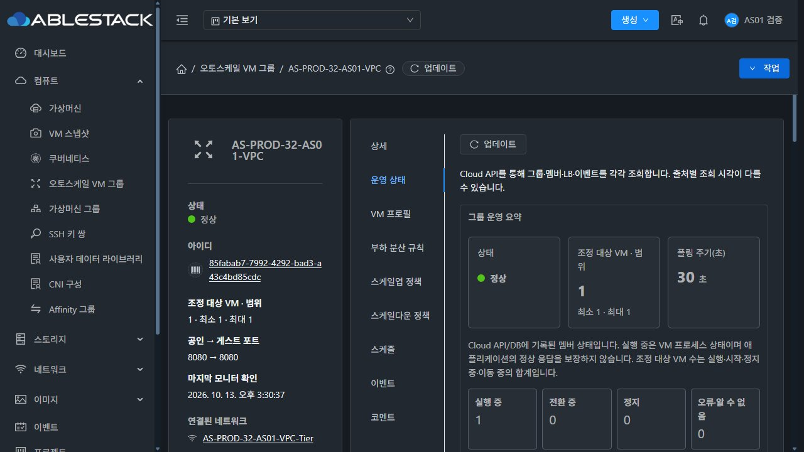

## 24시간 관찰 중단: 관리 서비스 재시작·배포 기준 변경 (2026-10-13)

**기존 11:44:15 시작 관찰은 31·32 모두 연속24시간 PASS 판정 대상에서 제외합니다.** 실패·공백·기준 변경을 지우거나 관찰 시작 시각을 덮어쓰지 않습니다. #1354는 Open, Epic #1346은 Closed, PR #1356은 MERGED를 유지합니다. 새 이슈/PR을 만들지 않았습니다.

| 환경 | 서비스 중지→시작 (KST) | 기존→현재 관리 PID | 관리 JAR SHA256 기존→현재 |
|---|---|---|---|
| 31 | 14:50:12→14:50:15 | 628863→646030 | `036f448a93ff…`→`5d47fc82e180…` |
| 32 | 14:58:40→14:58:45 | 938882→1158028 | `dce0e50d4b01…`→`4e2c97126c18…` |

- 두 서버 systemd 로그에 실제 Stopping/Stopped/Starting/Started가 있습니다. 종료 상태143(SIGTERM), NRestarts0입니다. 서비스 중지·시작은 확인했지만 실행 주체와 배포 목적은 확인되지 않았습니다. 관찰 작업에서는 배포·재시작·장애 주입을 수행하지 않았습니다.
- 관리 JAR 수정 시각은31 14:50:10,32 14:58:38 KST입니다. UI index SHA256도 양쪽 `aa31be6ec2e7…`에서 `e963669cee81…`로 바뀌었습니다. JAR 경로·전체 hash·파일 시각과 원래 기준은 증거 JSON에 보존했습니다.
- 15:22경 수집 상태: 양쪽 API 연결 거절1회씩, API 성공 기록 간격 최대31 **120.025초**,32 **120.163초**.32 재시작 직후 프로세스/JVM 수집 AttributeError1회도 보존했습니다.
- 애플리케이션 HTTP 세 대상은각 **2,625/2,625 본문 일치200·실패0**입니다. 그러나31 HTTP 수집 공백8건/최대 **55.939초**가 있어 그 공백의 서비스 정상 여부를 측정 결과로 주장하지 않습니다.32 HTTP 최대간격은5초입니다.
- 현재 관리 서비스 및 client HTTP200, 대상3그룹 Enabled/원본 VM1·활성LB1·인원범위 유지, 원본전체7VM/7그룹 및 각 서비스HTTP200·고아자원0을 확인했습니다.15:29~15:30 실제 UI의31프로젝트/32일반 사용자·VPC에서 최신 평가/그룹·멤버·LB·이벤트 조회 완료를 확인했습니다. 세션은 기존 계정으로 재인증했으며 설정은 바꾸지 않았습니다.

**판정:** 관찰 환경의 프로세스·배포 기준이 바뀌어 동일 기준 연속24시간 검증이 성립하지 않습니다. 이 사실만으로 오토스케일 구현 회귀라고 결론내리지 않습니다. 기존 서버 수집기는 원래 종료 시각까지 증거 수집을 계속하고, 원본 VM/ROOT·그룹·예약과 기존 기록을 보존합니다. 이 기간 종료를 이유로 #1354를 닫거나24시간 PASS를 선언하지 않습니다.

배포/재시작을 고정할 수 있는 시점을 조정한 뒤, 확정한 배포 기준을 재검증하고 **새24시간 구간**을 시작해야 합니다. 현재 기준을 자동 복구하거나 새 관찰 시작/종료 시각을 임의로 정하지 않습니다. 이미 병합한 Europa 제품 코드와 origin/로컬 기준은 변경하지 않았습니다.

[재시작·hash·공백 증거](summary.json)

## 현재 UI 증거

[조회 시각·멤버·LB·평가 DOM](ui-observations.json)
