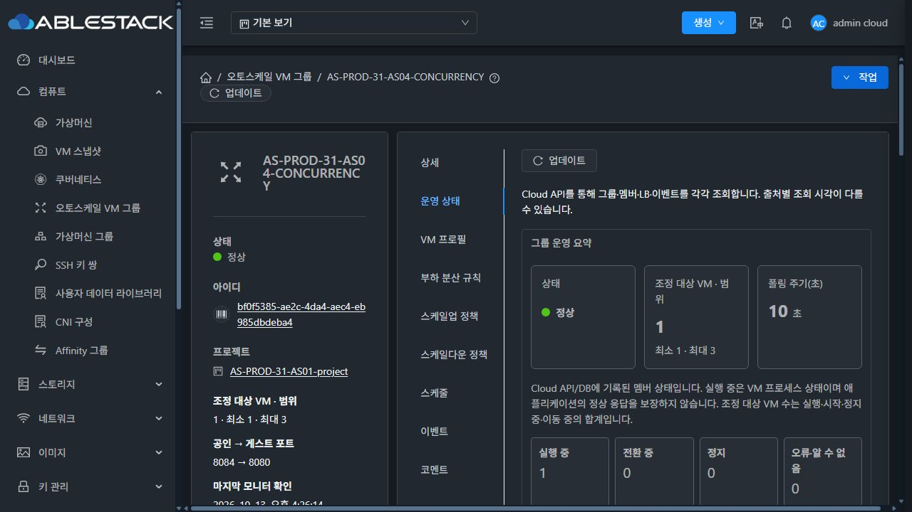
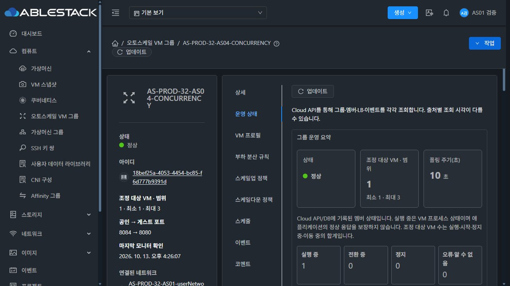
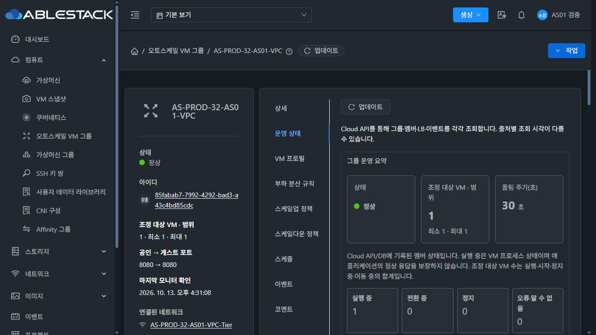

## 관리 서버 유지보수 중 서비스 관찰로 전환 (2026-10-13)

사용자는 다른 이슈의 배포·관리 서버 중단이 있더라도 VM/LB 서비스는 정상이어야 하므로 계속 관찰하도록 지시했습니다. 이전의 배포 완료 대기 계획은 이 지시로 대체합니다. 관찰 작업은 제품 배포/재시작/장애 주입/VM 시험/설정 변경을 수행하지 않습니다.

**현재 설치된 관리 JAR의 오토스케일 패키지·API·응답90개 class가31·32 모두 기존 검증본과 byte/hash 일치합니다.** 전체 JAR/UI hash·PID 변화만으로 오토스케일 구현 회귀로 판단하지 않습니다. 원래 구간의 재시작·API 오류·HTTP 수집 공백은 모두 보존하며 관리 서버 무중단24시간 PASS로 바꾸지 않습니다.

새 서비스 관찰은 **2026-10-13 16:15:33.985727~2026-10-14 16:15:33.985727 KST (24시간)** 입니다. 이전 구간을 덮어쓴 것이 아니라 외부 관측을 보강한 추가 구간입니다. 이 구간은 다른 기능의 관리 서버 배포/재시작을 허용합니다.

| 관측 위치 | 확인 주기/내용 |
|---|---|
| 관리 서버 두 독립 수집기 R6 | 앱HTTP5초/API60초/DB·프로세스·JVM·AS90 fingerprint5분 |
| 관리 서버 밖 WSL rocky | 세 앱 HTTP5초·본문hash·응답시간·실패 및 수집공백 |
| 기존 R5 | 기존 기한까지 증거를 계속 수집하고 기존 기록/판정 조건을 보존 |
| 채팅30분 예약 | 최신 UI·원본7VM/그룹·VM/LB/평가 복구·통계 보존·관측 기록 검토 |

- 관리 PID/전체 JAR/UI 변화와 관리 API 미수집은 환경 이력에 기록합니다. AS90 변경·그룹 설정 변경·원본 VM 손실·인원 범위/VM-LB 불일치·앱 HTTP 실패·평가 복구 실패는 별도로 점검합니다.
- API/JVM이 수집되지 않거나 오래된 값인 경우 기록을 보존합니다. 관리 서버가 돌아온 뒤 평가/멤버/LB 조회 복구를 확인합니다. PID별로 메모리·스레드·fd 추이를 분리하고 다른 작업의 공유 부하를 AS 누수로 단정하지 않습니다.
- 외부와 서버 HTTP 표본을 대상별로 합쳐 실제 관측 범위와 최대 미관측 간격을 확인합니다. 한 수집기의 공백을 숨기지 않습니다. 두 위치 모두 관측하지 못한 구간이나 실패를 정상으로 덮어쓰지 않습니다. 이것은 실제 표본에 대한 서비스 검증이며 모든 요청/SLA 인증으로 확대하지 않습니다.
- 서버 수집기는 Mold 관리 서비스와 독립 프로세스이고 기간 종료 뒤 자동 종료합니다. 외부 수집기는 WSL/PC 실행이 필요합니다. PC/WSL 중단도 수집 공백으로 남깁니다.

**사전 실행:** 두 서버 API1회/DB1회·AS90유지·실제 JVM지표 성공, HTTP 대상별7/7·오류0. 외부 HTTP 세 대상 각6/6·오류0/최대간격5초. 초기 약9분 관찰의 결합 표본은 대상별222개·최대간격약5초, 서비스/AS이상0입니다. 이는24시간 완료 결과가 아닙니다.

원본31 그룹3/VM3,32 그룹4/VM4 및 각 서비스HTTP200을 다시 확인했습니다. 현재 실제 UI의31프로젝트/32일반 사용자AS04와VPC에서 최신 그룹·멤버·LB·평가 조회를 확인합니다. GFS2 Thin은 사용하지 않습니다.

#1354만 Open, Epic #1346 Closed/PR #1356 MERGED를 유지합니다. 최종 충분한 기록·AS보존·최종UI 확인 후에만 #1354 완료 여부를 판정하고 활성화한3그룹을Disabled로 복원합니다. 원본7VM/ROOT·예약을 보존합니다. 새로운 제품 빌드/배포/이슈/PR을 수행하지 않았습니다. 이번 변경은 읽기 전용 관찰 도구와 증거 문서입니다.

[AS90 유지 근거](as-class-preservation.json) · [사전 실행 및 초기 관측](start-summary.json)

## 실제 UI

[최신 조회·평가·멤버/LB DOM](ui-observations.json)

## R6 1시간 체크포인트

[17:38 수집·최신 UI·메모리/통계 중간 확인](checkpoint-1h/README.ko.md). 24시간 최종 판정은 미완료다.
