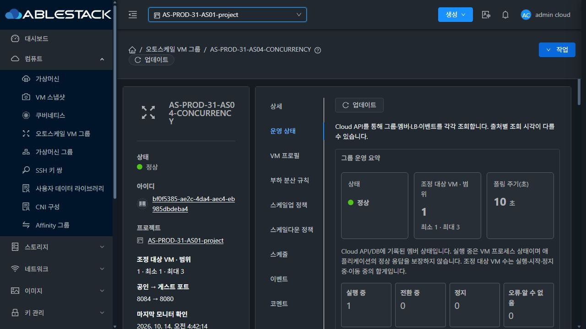
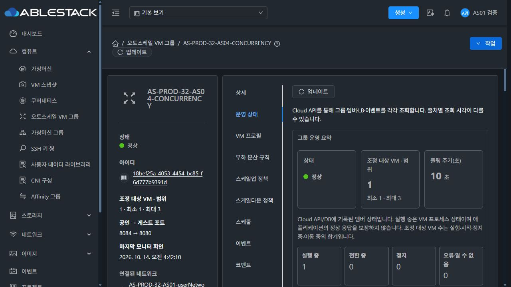

<!--
Licensed to the Apache Software Foundation (ASF) under one
or more contributor license agreements.  See the NOTICE file
distributed with this work for additional information
regarding copyright ownership.  The ASF licenses this file
to you under the Apache License, Version 2.0 (the
"License"); you may not use this file except in compliance
with the License.  You may obtain a copy of the License at

  http://www.apache.org/licenses/LICENSE-2.0

Unless required by applicable law or agreed to in writing,
software distributed under the License is distributed on an
"AS IS" BASIS, WITHOUT WARRANTIES OR CONDITIONS OF ANY
KIND, either express or implied.  See the License for the
specific language governing permissions and limitations
under the License.
-->

# R6 서비스 관찰 12시간 체크포인트 (#1354)

판정: **관찰 진행 중 · 기존31 서비스 장애 근본 원인 미확정**. 시작 2026-10-13 16:15:33 KST, 예정 종료 2026-10-14 16:15:33 KST를 유지한다. 누적 수집 기준은 2026-10-14 04:39:03 KST(약12시간23분)이며, 실제 UI/ROOT 재확인 시각은 아래 별도로 기록한다. 이전 실패·수집 공백·R5 구간을 초기화하거나 덮어쓰지 않았다.

## 애플리케이션 서비스

| 대상 | 서버 본문 일치200/표본 | 서버 실패 | 외부 본문 일치200/표본 | 외부 실패 | 두 경로 합산 최대 미관측 간격 |
|---|---:|---:|---:|---:|---:|
| 31-AS04 | 8920/8923 | 3 | 8921/8922 | 1 | 7.999초 |
| 32-AS04 | 8923/8923 | 0 | 8922/8922 | 0 | 5.001초 |
| 32-VPC | 8923/8923 | 0 | 8922/8922 | 0 | 5.001초 |

31 실패3/1은 [18:13에 이미 보고한 사건](../incident-20261013-1813/README.ko.md)이며 추가 실패는 없다. 단일 HAProxy backend L4 timeout과 UP 복구는 확인됐고 최초 게스트/호스트/네트워크 지연 원인은 미확정이다. 다른 시각의 관리 재시작을 해당 장애의 원인으로 연결하지 않는다.

서버 표본은04:39:03까지, 외부는04:38:58까지다. 두 경로의 요청을 하나의 성공 수로 합치지 않는다. 합산 간격은 측정 범위이며 실패 표본 사이를 성공 응답으로 보간하지 않는다. 서버 단독 최대 간격31 약9.158초/32 약5.004초, 외부 각 대상 약8.001초를 원본 timestamp와 함께 유지한다. 세 수집기는 PID/cmdline이 일치하며 runner.log는 비어 있다.

## 관리 유지보수와 복구

journal로 확인한 관리 서비스 stop/start는31 **6회**,32 **2회**다. 31의02:26/02:27 두 재시작 사이 약60초 프로세스는5분 프로세스 표본에서 관측되지 않았다. 해당 중간 PID·heap·AS 해시는 미확인으로 남기며 이후 PID와 혼합하지 않는다. collector의 PID 변화 경보는31 5건/32 2건이므로 journal 횟수와 구분한다.

| 환경 | 중지 요청 → 새 프로세스 시작(KST) | 최종 PID | API 첫 성공/안정 평가 복구(KST) | 성공 API 표본 간격 | 중단 전후 서비스 HTTP |
|---|---|---|---|---:|---|
| 31 | 10/13 20:22:26 → 20:22:28 | 693189 | 20:23:34 /20:24:34 | 약120.056초 | 서버·외부 실패0 |
| 31 | 10/13 21:23:47 → 21:23:49 | 702484 | 21:25:34 /21:25:34 | 약120.032초 | 서버·외부 실패0 |
| 31 | 10/13 21:42:12 → 21:42:15 | 706254 | 21:43:34 /후속 MIN_MEMBERS | 약119.973초 | 서버·외부 실패0 |
| 32 | 10/13 21:46:40 → 21:46:43 | 1202380 | 21:48:34 /후속 안정 평가 | 약120.020초 | AS04/VPC 서버·외부 실패0 |
| 31 | 10/14 02:26:18 → 02:26:21,02:27:21 → 02:27:40 | 중간 미관측 →748924 | 02:28:34 /02:29:34 | 약179.985초 | 서버107/외부107, 실패0 |
| 31 | 10/14 02:42:30 → 02:42:32 | 751698 | 02:43:34 /02:44:34 | 약120.009초 | 서버90/외부90, 실패0 |
| 32 | 10/14 02:45:44 → 02:45:47 | 1234242 | 02:47:34 /02:48:34 | 약120.036초 | AS04/VPC 각각 서버90/외부90, 실패0 |

각 대조 구간은 중지90초 전~마지막 시작360초 후다. 31의02:42 기록에서 처음 확인한 부분 구간65표본은 보존했고, 후속 전체 구간90표본도 확인했다. 최초 API 복구 직후 WAITING을 정상 평가로 바꾸지 않았으며 이후 실제 안정 평가와 UI로 복구를 확인했다. ROOT 추가 조회가 관리 API Connection refused로 한 번 실패한 기록과02:44 재시도 성공도 함께 보존했다. 관리 API 자체의 무중단을 주장하지 않는다.

31 API 성공738/오류6,32 성공742/오류2다. Connection refused·401·약120/180초 성공 표본 공백은 환경 이력에 남긴다. 전체 JAR/UI 변경과 별도로 AS 관련90개 클래스는 양쪽149개 프로세스 표본에서 검증본과 모두 일치한다. 표본 사이의 모든 순간이나 미관측 중간 PID까지 해시가 확인됐다고 주장하지 않는다. 환경 이벤트는31 배포11/API6/공백5/PID5,32 배포9/API2/공백2/PID2다.

## 자원·평가·실제 UI

- 세 관찰 그룹 Enabled/Running1/LB1, 두 AS04 범위1~3/VPC 범위1~1을 유지한다. 원본7그룹·7VM을 확인했고 API 그룹 ERROR/DB 고아 VM 매핑·삭제 VM 활성 볼륨은0이다. 설정 fingerprint 변경 경보가 없다. disabled 예약 및 기존 그룹은 변경하지 않았다.
- 04:42:38 KST 원본7VM의 ROOT7개 Ready/100GiB 및23:39 기준 동일 볼륨 ID를 재확인했다. 31 세 ROOT에 Thin은 없다. [ROOT 현재 확인](original-roots-current.json). 실제 이미지/krbd 경로 검증은 기존 최종 통합 게이트와 구분한다.
- 04:40~04:42 실제 Mold UI에서31 프로젝트 AS04와32 일반 사용자 AS04/VPC의 최신 조회·평가·Running/LB 등록을 확인했다. 두 AS04 CPU 표본7개/VPC2개를 확인했고 한글·다크 표시를 현재 화면에서 읽었다. 기존 계정으로 재로그인했으며 그룹/프로필/정책/예약을 변경하지 않았다. 전체 대화상자 회귀 시험은 이번 관찰에서 재실행하지 않았다.
- 일시적인 CPU 표본6개/WAITING은 미수집 표본을 보존해 평가 보류로 표시됐다. 31 02:08 보류→02:10 표본7/MIN_MEMBERS,32의 앞선 보류→후속 MIN_MEMBERS 증거를 포함했다. 성공 표본으로 채워 넣지 않았다. 최신 UI는 두 AS04 최소 인원 유지/VPC 조건 불충족이다.

## 통계 보존·PID별 자원 추이

양 서버 DB149표본/오류0, 프로세스149표본이다. 보존 설정7200초에서 oldest가 앞으로 이동하며 다음 범위를 유지했다. DB timestamp는 UTC다.

| 대상 | 통계 행 수 min~max /마지막 | oldest age min~max(초) |
|---|---|---|
| 31-AS04 | 1340~1422 /1410 | 7193.111~7250.116 |
| 32-AS04 | 1404~1416 /1406 | 7225.174~7258.207 |
| 32-VPC | 476~480 /476 | 7204.145~7254.19 |

jstat는 미설치 상태이며 실제 Cloud JVM collectiontime과heap을 사용했다. 새 PID 시작 이전·stale 값은 성공으로 처리하지 않는다. 아래는 PID별 min~max이며 여러 관리 프로세스를 연속 메모리 곡선으로 합치지 않았다.

| 환경·PID | 표본 | RSS(KiB) | 실제 heap(MiB, 반올림) | OS 스레드 | fd |
|---|---:|---|---|---|---|
| 31 · 646030 | 50 | 1484940~2008148 | 286~824 | 325~401 | 74~99 |
| 31 · 693189 | 12 | 1180544~1509228 | 262~638 | 249~275 | 59~72 |
| 31 · 702484 | 4 | 1242336~1482628 | 359~606 | 243~261 | 59~60 |
| 31 · 706254 | 57 | 1295616~1753352 | 227~724 | 259~307 | 63~81 |
| 31 · 748924 | 3 | 1260532~1402160 | 394~734 | 244~269 | 62~68 |
| 31 · 751698 | 23 | 1335688~1853096 | 257~839 | 255~304 | 68~74 |
| 32 · 1158028 | 67 | 1254348~1667008 | 232~598 | 308~383 | 54~72 |
| 32 · 1202380 | 60 | 1171376~1474540 | 222~710 | 279~328 | 50~67 |
| 32 · 1234242 | 22 | 1318444~1700392 | 303~660 | 281~325 | 51~65 |

현재 PID31=751698/32=1234242의 관측 기간은 약2시간 이하다. 실제 heap/RSS가 증감하는 기록을 유지하며 공유 관리 서버의 다른 VM/볼륨/템플릿 부하를 AS 누수로 단정하지 않는다. 전체 관리 프로세스24시간 무중단 메모리 시험으로 확대하지 않는다. 마지막 JVM collectiontime은31 04:35:02/32 04:35:26 KST다.

## 현재 판정과 다음 확인

12시간 중간 확인이며24시간 완료/무실패 PASS가 아니다. 기존31 서비스 장애의 최초 지연 원인과 최종 서비스 판정은 미완료다. #1354 Open, Epic Closed/PR #1356 MERGED를 유지한다. 제품 소스·배포·재시작·장애 주입·자원 생성/삭제·새 시험은 이 관찰에서 수행하지 않았다. GFS2 Thin 금지와 원본 보존을 유지하고 예정 종료 후 실제24시간 기록과 기존 실패를 함께 판정한다. 자동으로 그룹을 정리하거나 이슈를 닫지 않는다.

증거는 `checkpoint-analysis.json`의 HTTP/유지보수/통계/PID 구간, `summary.json`, 두 `cluster-*.json`, `process-series-*.json`, `db-series-*.json`, `ui-observations.json`, `original-roots-current.json`, 실패·재시도 ROOT 조회 및 transient 평가 기록으로 연결한다. private raw series는 ext4 전용 관찰 폴더에 보존했고 공개 자료에 비밀번호/API키/전체UserData/개인 키를 포함하지 않았다.
