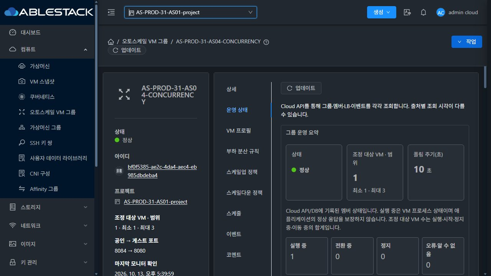
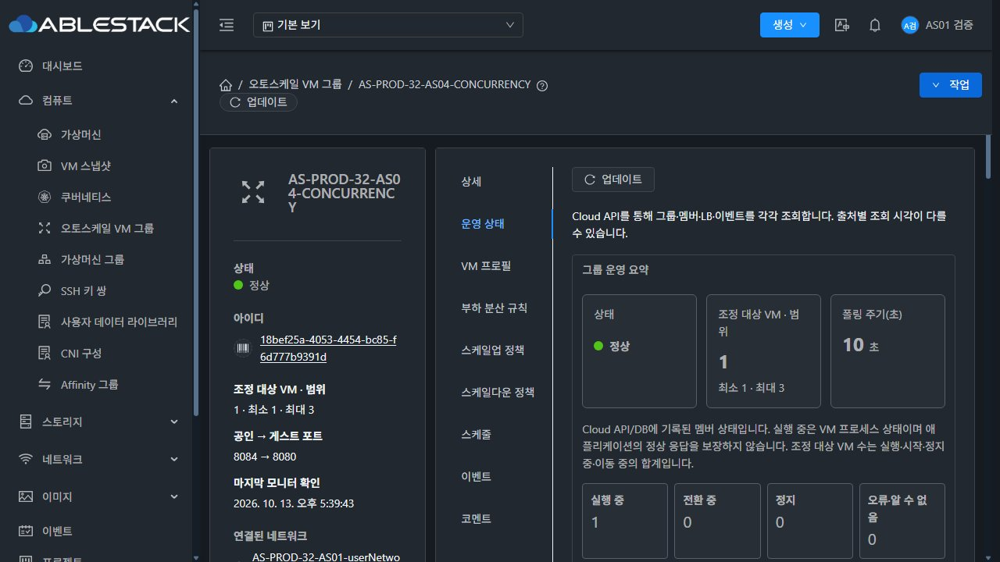
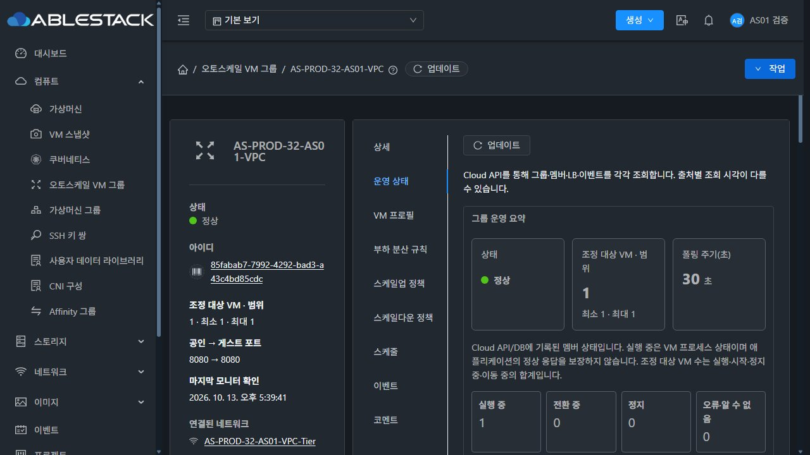

<!--
Licensed to the Apache Software Foundation (ASF) under one
or more contributor license agreements.  See the NOTICE file
distributed with this work for additional information
regarding copyright ownership.  The ASF licenses this file
to you under the Apache License, Version 2.0 (the
"License"); you may not use this file except in compliance
with the License.  You may obtain a copy of the License at

  http://www.apache.org/licenses/LICENSE-2.0

Unless required by applicable law or agreed to in writing,
software distributed under the License is distributed on an
"AS IS" BASIS, WITHOUT WARRANTIES OR CONDITIONS OF ANY
KIND, either express or implied.  See the License for the
specific language governing permissions and limitations
under the License.
-->

# R6 서비스 관찰 1시간 체크포인트 (#1354)

관찰 시작 **2026-10-13 16:15:33 KST**, 현재 수집 확인 **17:38:42 KST(약83분)**. 실제 UI는17:39~17:40, 프로세스/통계 추이는17:40까지 확인했다. 종료 예정은 **2026-10-14 16:15:33 KST**다. 현재는 중간 확인이며24시간 완료 판정이 아니다.

| 서비스 | 서버 표본 / 본문 일치200 | 외부 표본 / 본문 일치200 | 실패 | 두 수집기 합산 최대 미관측 간격 |
|---|---:|---:|---:|---:|
| 31-AS04 | 998 / 998 | 998 / 998 | 0 | 5.002초 |
| 32-AS04 | 998 / 998 | 998 / 998 | 0 | 5.000초 |
| 32-VPC | 998 / 998 | 998 / 998 | 0 | 5.001초 |

- 양 서버 API84회·DB17회, API/DB 오류·수집 이상·그룹 ERROR·고아 매핑/삭제 VM 활성볼륨0. API 최대 간격31=60.061초/32=60.188초. 외부 수집기의 최대 간격5.089초. 서버와 외부 표본은 동일 서비스를 중복 측정하므로 서비스 요청1996건으로 합산한 단일 수집기 결과로 표현하지 않는다.
- AS90개 클래스는 검증본과 계속 일치한다. 원본7VM/ROOT·7그룹, 그룹/프로필/정책/예약 fingerprint를 보존하고 대상3그룹은각Enabled·Running1·LB1·min/max범위 안이다. 실제31프로젝트 및32일반 사용자 AS04/VPC의 최신 평가·수집·조회시각·멤버 등록을 UI에서 확인했다.32유휴 브라우저 세션은 기존 계정으로 갱신했으며 서버/외부 수집은 정상이다.
- UI index 변경이31=16:55:34/32=17:00:34에 감지됐다. 전체 관리 JAR/PID는R6시작 값과 같고 AS90·서비스 응답은 유지됐다. 해당 정적 UI 변경을 환경 이력으로 보존한다. 이전R5의 관리 재시작·API 공백 기록은 그대로 유지하며 관리 서버까지 연속 무중단이었다고 주장하지 않는다.

| 관리 프로세스 | RSS 범위(MiB) | 실제 heap 범위(MiB) | OS 스레드 범위 | fd 범위 |
|---|---:|---:|---:|---:|
| 31 / PID646030 | 1453.2~1961.1 | 286.1~823.7 | 325~352 | 74~99 |
| 32 / PID1158028 | 1278.4~1627.9 | 293.9~598.4 | 308~343 | 56~70 |

프로세스별18개 표본(5분 주기)을 보존했다. Cloud JVM collectiontime의 실제 시각을 대조했으며 미수집·660초 초과 stale 표본0이다.32의 다른 VM/볼륨/템플릿 공유 작업을 포함한 관리 프로세스 전체 수치이므로 AS 메모리 누수 유무의 최종 판정으로 확대하지 않는다.

통계 retention설정7200초. oldest가31AS04 14:14:49→15:39:56,32AS04 14:14:48→15:39:51,32VPC 14:14:49→15:40:13 KST로 이동했다. 행수 범위31=1340~1418,32AS04=1404~1416,VPC=476~480. 실제 oldest age범위는7221.2~7250.2초로, 정리 주기에 따른2시간 부근 보존과 sliding 범위를 확인했다.

[수집 요약](summary.json), [PID별 메모리·통계 추이](process-statistics-trends.json), [UI 최신 조회/평가/멤버](ui-observations.json).

이번 관찰에서 배포/재시작·장애 주입·VM/그룹 설정 변경은 실행하지 않았다. PR#1356 MERGED/Epic#1346 Closed를 유지하고 #1354만 Open이다. 제품 코드·전체 Cloud/Actions 빌드 변경 없이 읽기 전용 관찰과 증거 문서만 갱신했다.
