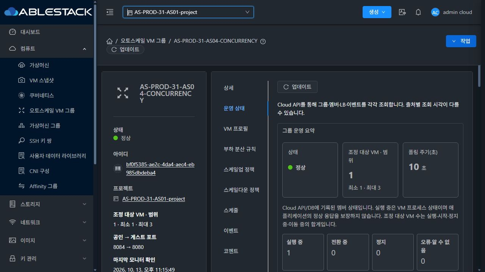
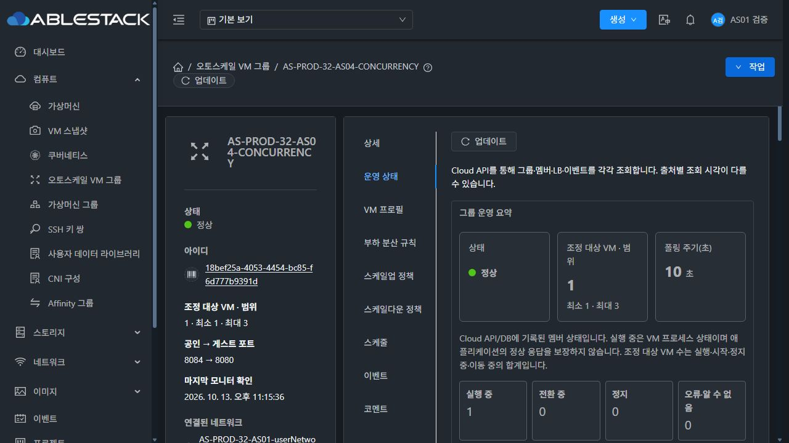

<!--
Licensed to the Apache Software Foundation (ASF) under one
or more contributor license agreements.  See the NOTICE file
distributed with this work for additional information
regarding copyright ownership.  The ASF licenses this file
to you under the Apache License, Version 2.0 (the
"License"); you may not use this file except in compliance
with the License.  You may obtain a copy of the License at

  http://www.apache.org/licenses/LICENSE-2.0

Unless required by applicable law or agreed to in writing,
software distributed under the License is distributed on an
"AS IS" BASIS, WITHOUT WARRANTIES OR CONDITIONS OF ANY
KIND, either express or implied.  See the License for the
specific language governing permissions and limitations
under the License.
-->

# R6 서비스 관찰 6시간 체크포인트 (#1354)

판정: **관찰 진행 중 · 기록된 서비스 장애의 근본 원인 미확정**. 무실패 PASS나 24시간 완료 판정이 아니다. 시작은 2026-10-13 16:15:33 KST, 예정 종료는 2026-10-14 16:15:33 KST로 유지한다. 아래 누적 수집 기준은 2026-10-13 23:13:21 KST(6시간 57분 47초)다. 6시간 체크포인트의 게시가 늦어졌지만 서버·외부 수집은 지속됐으며 이전 기록과 실패를 초기화하지 않았다.

## 서비스와 수집 범위

| 대상 | 서버 HTTP 본문 일치200/표본 | 서버 실패 | 외부 HTTP 본문 일치200/표본 | 외부 실패 | 양 경로 합산 최대 미관측 간격 |
|---|---:|---:|---:|---:|---:|
| 31 AS04 | 5011/5014 | 3 | 5013/5014 | 1 | 7.999초 |
| 32 AS04 | 5014/5014 | 0 | 5014/5014 | 0 | 5.001초 |
| 32 VPC | 5014/5014 | 0 | 5014/5014 | 0 | 5.001초 |

두 경로는 같은 대상에 대한 독립 표본이다. 합산 시간 범위는 **측정 여부**를 뜻하며 HTTP 실패를 정상으로 바꾸거나 실패 사이를 성공으로 보간하지 않는다. 서버 최대 표본 간격은 31 약9.158초/32 약5.004초, 외부는 각 대상 약8.001초다. 외부 수집기는 세 대상을 순서대로 확인하므로 31 timeout 당시 다른 대상의 표본 간격도 늘었다. 원본 timestamp와 두 경로를 함께 유지한다. 이번 확인에서 알려진 18:13 장애 이후의 새 HTTP 실패 증가는 없다.

31 API 성공415회/오류3회, 32 성공417회/오류1회. 양쪽 DB와 관리 프로세스는 각각84회 수집됐고 DB 오류0이다. API 오류는 아래 관리 서버 중단 전후에 발생했고 Connection refused 또는 일시401 응답으로 보존한다. 수집기가 관리 서비스의 중단 시각을 매초 측정한 것으로 주장하지 않는다. 서버 수집기 두 개와 외부 수집기의 PID/cmdline은 계속 일치하며 runner.log는 비어 있다.

## 관리 서버 중단과 서비스 대조

관리 서비스의 종료·시작은 systemd journal로 확인했다. 전체 JAR/UI hash 변화는 환경 이력이며 AS 관련90개 클래스는 양 서버의84개 프로세스 표본에서 모두 검증본과 일치했다. 표본 사이의 모든 순간까지 해시를 측정한 것은 아니다.

| 환경 | 중지 요청 → 새 프로세스 시작(KST) | PID 이전 → 이후 | API 오류 → 다음 성공(KST) | API 성공 표본 간격 | 중단 전후 HTTP 표본 |
|---|---|---|---|---:|---|
| 31 | 20:22:26 → 20:22:28 | 646030 → 693189 | 20:22:34 → 20:23:34 | 120.056초 | 서버90/외부90, 실패0 |
| 31 | 21:23:47 → 21:23:49 | 693189 → 702484 | 21:24:34 → 21:25:34 | 120.032초 | 서버91/외부91, 실패0 |
| 31 | 21:42:12 → 21:42:15 | 702484 → 706254 | 21:42:34 → 21:43:34 | 119.973초 | 서버91/외부91, 실패0 |
| 32 | 21:46:40 → 21:46:43 | 1158028 → 1202380 | 21:47:34 → 21:48:34 | 120.020초 | AS04/VPC 각각 서버90/외부90, 실패0 |

각 HTTP 대조 구간은 중지 요청90초 전부터 새 프로세스 시작360초 후까지다. API가 먼저 복구된 직후 AS04는 WAITING 또는 MIN_MEMBERS를 반환했고 최신 평가·UI에서는 두 AS04 모두 최소1명 유지, VPC는 조건 불충족(NO_ACTION)을 확인했다. 관리 API 무중단이라고 표현하지 않는다. 31·32의 추가 정적 UI 변경도 환경 로그에 보존한다.

## 자원·운영 상태와 UI

- 원본7개 그룹/VM은 유지된다. 관찰 대상3개는 Enabled/Running1/LB1이고 범위는 AS04 최소1~최대3, VPC 최소1~최대1이다. API/DB 고아 VM 매핑·삭제 VM 활성볼륨 및 해당 그룹 ERROR 이벤트0이다. 프로필/정책/예약 설정 fingerprint 변경 경보가 없다.
- 23:39:21 KST 별도 읽기 전용 API 확인에서 원본7개 VM에 연결된 ROOT7개 모두 Ready/100GiB를 확인했다. 31 세 ROOT의 Thin은 없다. [현재 ROOT 확인](original-roots-current.json)은 수집 누적 기준시각과 구분한다.
- 23:14~23:17 실제 Mold UI에서 31 프로젝트 문맥 AS04, 32 일반 사용자 AS04 및 VPC의 최신 조회 시각·정책 평가·Running/LB 등록을 확인했다. 두 AS04 CPU 표본7개와 VPC 표본2개를 확인했다. 기존 계정으로 재로그인했고 그룹·프로필·정책·예약을 변경하지 않았다. 한글과 다크 표시를 실제 화면으로 확인했다. 전체 대화상자 회귀 시험을 이번 관찰에서 재실행한 것은 아니다.

## 통계와 관리 프로세스 추이

통계 보존 설정은7200초다. 오래된 행 시각이 앞으로 이동하고 행 수는 다음 범위에서 유지됐다. DB timestamp는 UTC이며 아래 값은 수집 시각 기준 age다.

| 대상 | 84개 DB 표본의 행 수 범위 | 마지막 행 수 | oldest age 범위 |
|---|---:|---:|---:|
| 31 AS04 | 1340~1422 | 1408 | 7193.111~7250.116초 |
| 32 AS04 | 1404~1416 | 1408 | 7225.174~7258.207초 |
| 32 VPC | 476~480 | 478 | 7204.145~7254.190초 |

jstat는 미설치 상태다. 실제 Cloud JVM collectiontime/heap을 사용했고 새 PID 시작 이전 값이나 stale값을 성공으로 처리하지 않는다. 아래는 PID별 min~max이며 새 프로세스를 하나의 연속 메모리 곡선으로 합치지 않았다.

| 환경·PID | 표본 수 | RSS(KiB) | 실제 heap(MiB, 반올림) | OS 스레드 | fd |
| 31 · 646030 | 50 | 1484940~2008148 | 286~824 | 325~401 | 74~99 |
| 31 · 693189 | 12 | 1180544~1509228 | 262~638 | 249~275 | 59~72 |
| 31 · 702484 | 4 | 1242336~1482628 | 359~606 | 243~261 | 59~60 |
| 31 · 706254 | 18 | 1295616~1621552 | 304~547 | 259~286 | 63~72 |
| 32 · 1158028 | 67 | 1254348~1667008 | 232~598 | 308~383 | 54~72 |
| 32 · 1202380 | 17 | 1172240~1474540 | 242~710 | 279~304 | 50~63 |

공유 관리 서버의 다른 VM/볼륨/템플릿 작업 부하를 AS 누수로 단정하지 않는다. 새 PID의 표본 기간이 짧으므로 장기 메모리 안정성의 최종 판정은 미완료다. 최신 collectiontime은 31 23:09:44/32 23:10:21 KST이고 해당 프로세스 시작 이후 값이다.

## 이미 보고한 장애와 남은 판정

[18:13 장애 증거](../incident-20261013-1813/README.ko.md): 31-AS04 서버3/외부1 실패, HAProxy 단일 backend L4 timeout·UP 복구를 확인했다. 게스트 웹 서비스 PID와 재시작 횟수는 유지됐으나 최초 게스트/호스트/네트워크 지연 원인은 미확정이다. 이번 누적 실패는 같은 사건이며 새 장애로 중복 보고하지 않는다. 관리 서버 재시작 사건과 당시 서비스 장애는 시각이 다르다.

관찰 시작/종료와 실패를 보존해 #1354 Open 상태로 계속한다. 최소24시간 실제 서비스 기록, 기존 장애 원인/영향 및 최종 서비스 판정은 아직 완료되지 않았다. 병합된 PR #1356이나 닫힌 Epic/구현 이슈를 다시 변경하지 않았다. 제품 소스·배포·재시작·장애 주입·자원 정리·전체 빌드는 이 관찰에서 수행하지 않았다.

증거: `summary.json`, 두 `cluster-*.json`, `external-status.json`/`external-anomalies.json`, `maintenance-and-runtime-review.json`, PID별 원본 `process-series-*.json`, `db-series-*.json`, `ui-observations.json`, `original-roots-current.json`. 비밀번호/API키/전체UserData/개인 키를 포함하지 않는다.
