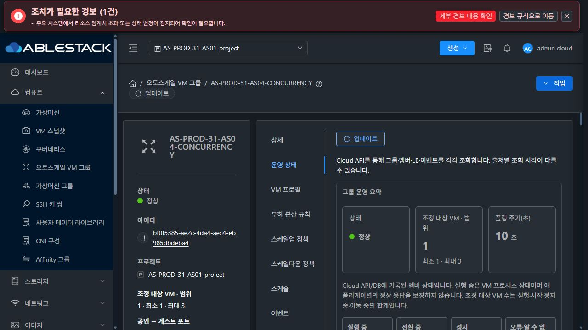
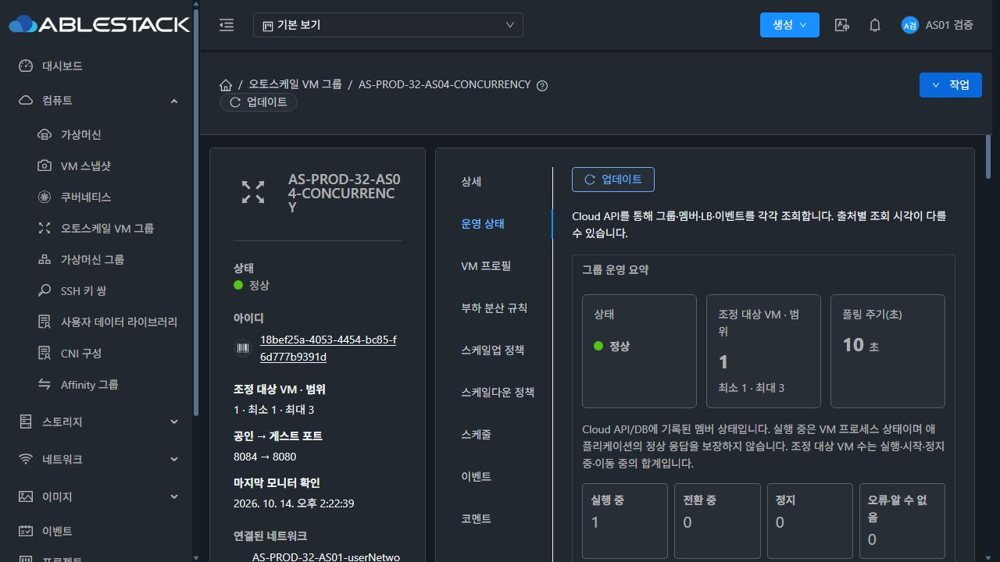

<!--
Licensed to the Apache Software Foundation (ASF) under one
or more contributor license agreements.  See the NOTICE file
distributed with this work for additional information
regarding copyright ownership.  The ASF licenses this file
to you under the Apache License, Version 2.0 (the
"License"); you may not use this file except in compliance
with the License.  You may obtain a copy of the License at

  http://www.apache.org/licenses/LICENSE-2.0

Unless required by applicable law or agreed to in writing,
software distributed under the License is distributed on an
"AS IS" BASIS, WITHOUT WARRANTIES OR CONDITIONS OF ANY
KIND, either express or implied.  See the License for the
specific language governing permissions and limitations
under the License.
-->

# #1354 운영 관찰 결과 및 예약 삭제 보고

판정: **무중단 PASS 불가 · 원본 자원 보존 확인 · 서비스 장애 근본 원인 미확정**. 사용자 요청에 따라 지금까지의 결과를 보고하고 예약 작업 `1354-31-32`를 삭제했다. #1354 Open, Epic #1346 Closed, PR #1356 MERGED(`9fa65ce2a27b977e848440cb7c787411c11d585b`)를 유지한다.

## 관찰 기간과 종료 상태

- **R5 완료 구간:** 2026-10-13 11:44:15~2026-10-14 11:44:15 KST. 양 서버 수집기 상태는 FINISHED이고 실제 HTTP 첫/마지막 기록이24시간 범위를 덮는다. 관리 서버 중단·배포 변경·HTTP 실패·수집 간격을 포함한 기록이며 엄격한 무중단24시간 PASS가 아니다.
- **R6 서비스 구간:** 2026-10-13 16:15:33~2026-10-14 16:15:33 KST가 기존 계획이다. 이 보고서의 고정 수집 기준은 **2026-10-14 14:19:36 KST(22시간 4분 2초)**다. R6 수집기는 아직 OBSERVING이므로 이를 완료된24시간 결과로 표현하지 않는다.
- R5와 R6는 시간 범위가 겹치는 독립 수집이다. 같은18:13 장애의 실패 표본을 합산해 새 장애로 세지 않는다. 시작·종료·실패·공백을 초기화하지 않았다.

## 완료된 R5의 앱 HTTP

| 대상 | 본문 일치 HTTP200/표본 | 실패 | 원본 요청 시작 timestamp 최대 간격 |
|---|---:|---:|---:|
| 31-AS04 | 17,278/17,281 | 3 | 55.960초 |
| 32-AS04 | 17,281/17,281 | 0 | 5.009초 |
| 32-VPC | 17,281/17,281 | 0 | 5.009초 |

R5 첫 표본은10/13 11:44:15.75, 마지막은10/14 11:44:15.75 KST다. 31의 약55.960초 최대 시작 간격은 원본 timestamp 재계산값이며 수집기 `maxHttpGapSeconds=55.939`도 [원본 요약](r5-final-summary.json)에 별도로 보존했다. 이 공백을 HTTP 정상 구간으로 채우지 않는다. 32 원본 시작 timestamp 최대 간격은 약5.009초다.

R5 API 성공 표본31 1,435/오류6,32 1,438/오류3이며 성공 표본 최대 간격은 각각 약120.123/120.163초다. 양 서버 DB289표본/오류0이다. PID·전체 JAR/UI 기준 차이로 누적된 반복 경보31 525/32 506은 새 장애 수가 아니다. R5 종료 표본의 PID/heap은11:44의 이력값이며 현재 PID로 제시하지 않는다.

## R6의 외부·서버 서비스 교차 확인

| 대상 | 서버 본문 일치200/표본 | 외부 본문 일치200/표본 | 두 경로 합산 최대 미관측 간격 |
|---|---:|---:|---:|
| 31-AS04 | 15,886/15,889 · 실패3 | 15,887/15,888 · 실패1 | 7.999초 |
| 32-AS04 | 15,889/15,889 · 실패0 | 15,888/15,888 · 실패0 | 5.001초 |
| 32-VPC | 15,889/15,889 · 실패0 | 15,888/15,888 · 실패0 | 5.001초 |

서버 표본은2026-10-14 14:19:33, 외부는2026-10-14 14:19:28 KST까지다. 성공 횟수를 경로 간 합산해 가용성으로 표현하지 않았고, 실패 표본 사이를 성공으로 보간하지 않았다. 외부/서버 수집은5초 주기이며 PC/WSL 공백과 실제 timestamp 간격을 구분한다. 서버 단독 시작 간격31 약9.158초/32 약5.004초, 외부 각 대상 약8.001초다. 관측 간격이0초였거나 모든 순간을 확인했다는 의미가 아니다.

### 31 서비스 장애

10/13 18:13에31-AS04에서 timeout/RemoteDisconnected가 발생했다. R6 서버3/외부1 실패는 [기존 장애 보고](../incident-20261013-1813/README.ko.md)와 동일하며 이후 추가 HTTP 실패는 없다. 외부18:13:49, 서버18:13:58에HTTP200을 다시 확인했다. VR r-395-VM의 HAProxy는18:13:50 단일 backend L4 timeout/active0,18:13:54 UP/active1이었다. 게스트 `as01-web.service` PID769/NRestarts0은 유지됐고 요청 기록에 공백이 있었다.

확인된 경로는 단일 LB backend의 일시적 불가와 복구다. 최초 게스트/호스트/네트워크 지연 원인은 미확정이다. 관리 재시작·후속 VM 통계 문제를 이 사건의 근본 원인으로 연결하지 않는다. R5의 별도 요청3실패도 같은 사건 시간대의 관측이다.

## 관리 유지보수·평가 수집과 서비스 영향

R6 누적 journal 증거를 보존한 관리 stop/start는31 **7회**,32 **3회**다. 현재 journal이 회전해 이전 날짜 전체가 재조회되지 않는 부분은 이미 보존한 체크포인트·maintenance 증거로 대조했다. PID 변경 표본은31 6건/32 3건이므로 실제 재시작 횟수와 다르다.

31: 10/13 20:22·21:23·21:42,10/14 02:26·02:27·02:42·11:59. 32: 10/13 21:46,10/14 02:45·12:02. 각 재시작 전후 앱 HTTP 추가 실패는0이었다. API Connection refused/401과 약120~180초 성공 표본 간격을 보존했고 이후 안정 평가가 회복됐다. 31의02:26/02:27 사이 약60초 중간 PID/heap은5분 표본에 미관측이며 이후 PID 값으로 채우지 않았다.

R6 API 성공31 1,318/오류7,32 1,322/오류3. 성공 API 표본 최대 간격31 약179.985초/32 약120.131초다. 관리/API 자체의 무중단은 통과하지 않았다. 전체 JAR/UI hash 변화는 환경 이력으로 기록했고 AS90·그룹 설정·원본 VM/LB를 별도로 평가했다.

- 32-AS04 10/14 08:08:59 `COLLECTION_UNAVAILABLE` 평가 보류→08:09:59 안정 평가 회복. 해당 창에 서비스 HTTP 추가 실패0, 최초 수집 문제 원인 미확정. [증거](transient32-evaluation-review.json).
- 31-AS04 10/14 14:09:07 `COLLECTION_UNAVAILABLE`→14:10:07 `MISSING_SAMPLE`(표본0·수집 시각 없음)→14:11:07 표본7/MIN_MEMBERS 회복. 관리 로그는14:09:05에31-1의GetVmStatsAnswer를 약65ms 후 수신하고 VM 통계 빈 결과를 경고했다. 빈 응답의 근본 원인은 미확정이다. 14:07~14:13:53 서버83/외부83 표본에서 추가 실패0. 미수집 평가를 성공으로 취급하지 않았다. [평가 증거](transient31-evaluation-review.json), [요청 로그](transient31-request-review.json).

## 자원 보존과 현재 UI

- 원본7그룹·7VM 유지, 세 관찰 그룹 Running1/LB1. 두 AS04 min1/max3,32VPC min1/max1. 설정 fingerprint 변경 경보 없음, API 그룹 오류·DB 고아 VM 매핑/볼륨 행0.
- 2026-10-14 14:23:02 KST에 ROOT7개 Ready/100GiB 및 기존 ID 동일을 재확인했다. 31 GFS2 Thin 없음. 원본 및 비활성 예약은 보존했다. [ROOT 확인](original-roots-current.json).
- 14:22:38~14:22:46 실제 Mold UI의31 프로젝트 AS04와32 일반 사용자 AS04/VPC를 읽기 전용 확인했다. 멤버1대 실행 중·LB 등록, 두 AS04 최신 표본7/최소 멤버 유지·VPC 표본2/조건 불충족이었다. UI 값만으로 서비스 성공을 판정하지 않고 독립 HTTP와 대조했다. [UI 원본](ui-observations.json).
- 양 서버 R6 프로세스265표본에서 AS 관련90개 class가 검증본과 일치했다. 표본 사이 모든 순간과 미관측 중간 PID까지 확인한 것은 아니다. 실제 UI 최신 자산 변경은 환경 이력에 포함했고 전체 모달 회귀 시험·새 부하 시험·빌드는 수행하지 않았다.

## 통계 retention과 PID별 메모리

R6 양 서버 DB265표본/오류0. retention7200초에서 oldest/newest가 앞으로 이동했다. 아래 DB timestamp는UTC다.

| 대상 | 행 수 min~max /마지막 | oldest age min~max | 마지막 oldest →newest(UTC) |
|---|---|---|---|
| 31-AS04 | 1340~1422 /1420 | 7193.111~7259.096초 | 2026-10-14 03:15:15.000000 →2026-10-14 05:15:31.000000 |
| 32-AS04 | 1402~1416 /1412 | 7213.176~7258.207초 | 2026-10-14 03:15:07.000000 →2026-10-14 05:15:29.000000 |
| 32-VPC | 474~480 /478 | 7195.187~7254.190초 | 2026-10-14 03:15:16.000000 →2026-10-14 05:15:14.000000 |

jstat 미설치 상태에서 실제 Cloud collectiontime/heap을 사용하고 PID별로 분리했다. 현재 PID31=834619(11:59:21 시작),32=1293012(12:02:02 시작)이며 마지막 JVM collectiontime은14:14:51/14:14:41 KST다. 초기 PID 시작 시각은아래 분석 자료에 미확인으로 남아 있다. 표본의 실제 metrics 시각과 수집 시각을 함께 보존했고 미관측 중간 PID 값은 없으며 이를 무중단24시간 JVM 검증으로 주장하지 않는다.

| 환경·PID | 표본 | RSS KiB min~max /마지막 | 실제 heap MiB min~max /마지막 | OS 스레드 min~max /마지막 | fd min~max /마지막 |
|---|---:|---|---|---|---|
| 31 · 646030 | 50 | 1484940~2008148 /1493208 | 286.1~823.7 /460.2 | 325~401 /401 | 74~99 /85 |
| 31 · 693189 | 12 | 1180544~1509228 /1453080 | 262.2~637.7 /637.7 | 249~275 /267 | 59~72 /67 |
| 31 · 702484 | 4 | 1242336~1482628 /1242336 | 359.3~605.7 /359.3 | 243~261 /261 | 59~60 /59 |
| 31 · 706254 | 57 | 1295616~1753352 /1469120 | 226.7~723.7 /226.7 | 259~307 /305 | 63~81 /71 |
| 31 · 748924 | 3 | 1260532~1402160 /1260532 | 394.2~734.3 /395.3 | 244~269 /269 | 62~68 /68 |
| 31 · 751698 | 111 | 1254024~2008284 /1536132 | 217.0~945.2 /310.4 | 255~453 /453 | 64~120 /89 |
| 31 · 834619 | 28 | 1277160~1668744 /1490400 | 244.4~580.2 /361.4 | 252~400 /400 | 73~109 /77 |
| 32 · 1158028 | 67 | 1254348~1667008 /1353476 | 232.1~598.4 /288.8 | 308~383 /383 | 54~72 /65 |
| 32 · 1202380 | 60 | 1171376~1474540 /1189900 | 222.4~709.9 /255.8 | 279~328 /326 | 50~67 /63 |
| 32 · 1234242 | 111 | 1293632~1700392 /1359260 | 262.2~659.6 /385.3 | 281~400 /398 | 51~66 /60 |
| 32 · 1293012 | 27 | 1322408~1680876 /1399112 | 271.5~775.5 /303.0 | 273~335 /333 | 56~65 /58 |

RSS/heap은 상승과 하락을 모두 보였고31의 일부 PID에서는 OS 스레드 수가 증가했다. 공유 관리 서버의 다른 VM·볼륨·템플릿 작업도 포함되므로 이를 AS 누수로 확정하거나 누수가 없다고 PASS하지 않는다. PID 교체로 감소한 값 역시 누수 회복 근거가 아니다. 전체 시각·PID별 범위는 [분석 JSON](checkpoint-analysis.json)에 남겼다.

## 예약 삭제 및 남은 판정

예약 작업 **`1354-31-32` 삭제 성공**을 앱 도구의 `deleteStatus=deleted`와 설정 파일 부재로 확인했다. 일시정지가 아니며 새 예약을 만들지 않았다. [처리 기록](operator-disposition.json).

예약 삭제는 독립 R6 수집기 종료와 구분한다. 요청 시점에는 기존 기한16:15:33까지 남아 있어 세 R6 수집기는 원래의 자동 종료를 유지한다. 이 보고를 R6의24시간 완료 체크포인트로 등록하지 않았다. 24시간 미충족 및 근본 원인/서비스 최종 판정 미해결 때문에 #1354를 닫거나 state COMPLETE로 변경하지 않았다. Enabled 세 그룹은 아직복원하지 않았고 원본7VM/ROOT·비활성 예약은 보존했다.

원시 HTTP/API/DB/process 전체 series는 WSL ext4 전용 관찰 폴더에 보존했다. 공개 자료는 요약·필요 증거만 포함하며 비밀번호/API키/개인 키/전체UserData를 포함하지 않는다. 제품 Europa 소스·배포·재시작·새 PR/이슈/채팅·전체 Cloud/Actions 빌드는 변경/시작하지 않았다.
