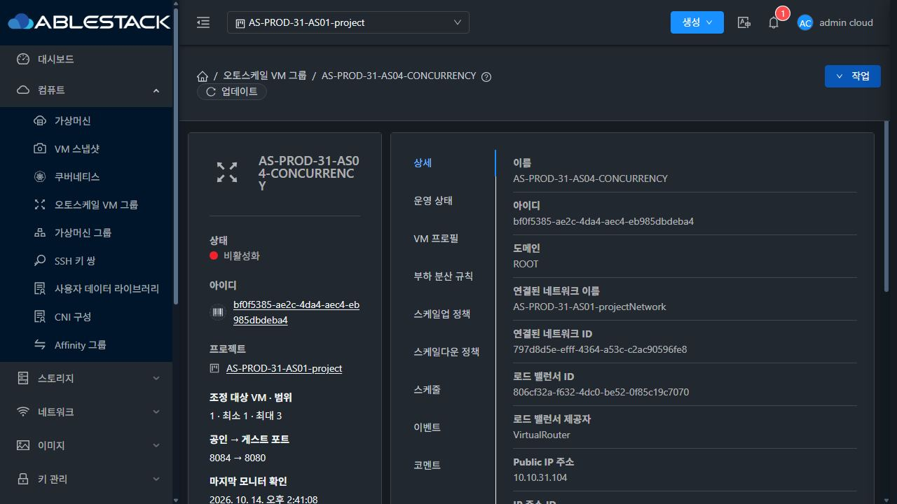
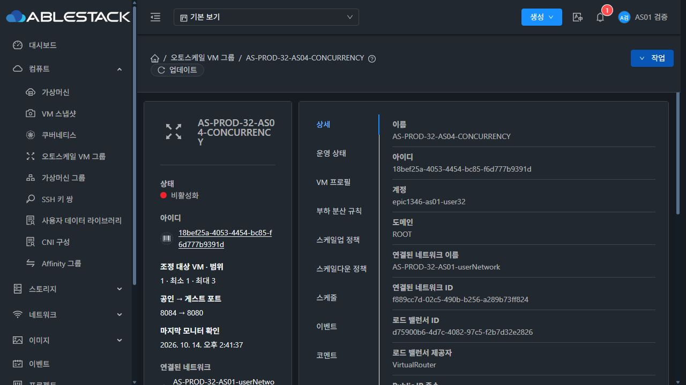
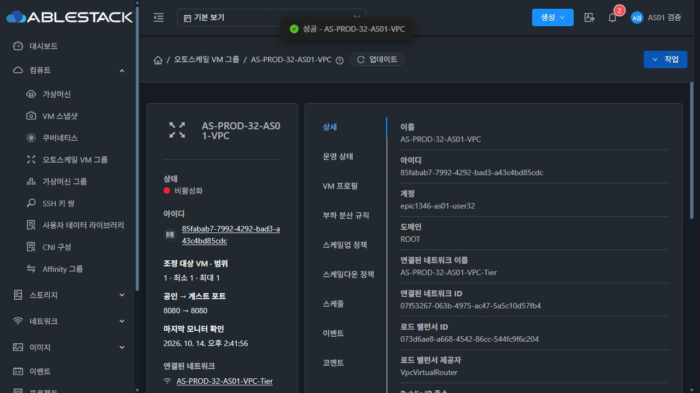

<!--
Licensed to the Apache Software Foundation (ASF) under one
or more contributor license agreements.  See the NOTICE file
distributed with this work for additional information
regarding copyright ownership.  The ASF licenses this file
to you under the Apache License, Version 2.0 (the
"License"); you may not use this file except in compliance
with the License.  You may obtain a copy of the License at

  http://www.apache.org/licenses/LICENSE-2.0

Unless required by applicable law or agreed to in writing,
software distributed under the License is distributed on an
"AS IS" BASIS, WITHOUT WARRANTIES OR CONDITIONS OF ANY
KIND, either express or implied.  See the License for the
specific language governing permissions and limitations
under the License.
-->

# AS-08 및 Epic 전체 최종 성공 판정 — 사용자 승인

**최종 판정: PASS(사용자 승인) · AS-08 완료 · Epic #1346 전체 9/9 완료.** 2026-10-14 사용자가 기존24시간 운영을 성공으로 판단하고 #1354 종료와 Epic 전체 성공 판정·종료를 명시적으로 승인했다. 관리 서버 중단 및 기존 미관측/환경 문제는 개발한 기능의 결함으로 취급하지 않는다는 사용자 판정을 적용한다.

## 승인 근거와 계측 이력

R5는2026-10-13 11:44:15~2026-10-14 11:44:15 KST의24시간 기록이며 양 서버 수집기 FINISHED를 확인했다. 선행8이슈의 구현·해당 모듈/UI 빌드·배포·실제 UI 검증 및 AS-08 대표 통합 게이트와 운영 증거를 합쳐 전체 기능 운영 검증을 완료로 승인했다.

[승인 이전 운영 보고](../operator-report-20261014/README.ko.md)는 그대로 보존한다. 서버 HTTP 실패·외부 실패·API 공백·통계 수집 보류·관리 재시작·미관측 구간과 근본 원인 미확정이라는 계측 사실을 삭제하거나 정상 표본으로 바꾸지 않았다. 새로운 실패0 계측 결과나 R6 별도24시간 완주를 만들어 주장하지 않는다. **기능 운영 성공 판정의 근거는 사용자 승인**이며 이전 계측 기준의 미완료/미승인 처분은 이번 최종 승인으로 대체된다. [사용자 최종 판정 기록](user-acceptance.json).

## 관찰 종료 및 원복

- 관찰 종료 시각과 기존 시작/예정 종료를 모두 보존했다. 승인 시점의 R6는약22시간21분 기록이며 사용자 최종 승인으로 종료했다. 재시작/새 시험/새 예약/제품 변경은 수행하지 않았다.
- 전용 수집기31 PID655853,32 PID1168896,외부 PID273의 명령행·전용 status PID를 대조한 뒤 SIGTERM으로 정리했고 종료를 확인했다. 관리 서비스 PID를 정리하지 않았고 원시 증거 파일은 삭제하지 않았다. [31 정리](collector-stop-31.json), [32 정리](collector-stop-32.json), [외부 정리](collector-stop-external.json).
- 실제 Mold UI에서31 프로젝트 AS04,32 일반 사용자 AS04/VPC **세 그룹을 Disabled로 복원**했다. 그룹 삭제와 VM/ROOT 삭제는 수행하지 않았다. [UI 원본](restoration-ui.json).
- 원복 후7그룹·7VM 실행 중/LB 매핑, ROOT7 Ready/100GiB·동일 ID, 기존 비활성 예약을 확인했다. 전체7그룹 앱 HTTP200/본문 일치와31 GFS2 Thin 부재도 확인했다. [원복 API/HTTP 대조](restoration-verification.json), [ROOT 확인](original-roots-current.json).
- 예약 작업 `1354-31-32`는 이전 요청에서 삭제됐으며 삭제 상태를 유지한다. state를 COMPLETE 및 PASS_USER_ACCEPTED로 마감하고 #1354를 Completed로 닫는다. Epic #1346은Closed 유지하면서 전체 성공 판정과9개 하위 이슈 완료 체크리스트를 반영한다. PR #1356의 병합 커밋 `9fa65ce2a27b977e848440cb7c787411c11d585b`는 그대로다.

## 완료 범위

AS-01~AS-09 모두 완료. 관리 서버 운영 내부 이슈와 기록된 미관측을 사용자 기준에 따라 기능 실패로 분류하지 않는다. 원시 측정의 무실패 여부를 변경하거나 별도 내부 이슈의 근본 원인이 기술적으로 새로 확정됐다고 기록하지 않는다. 이번 작업은 승인·완료 판정·관찰 원복·문서 및 GitHub 상태 갱신이며 전체 Cloud/Actions 빌드나 새 PR/이슈/채팅은 시작하지 않았다.
