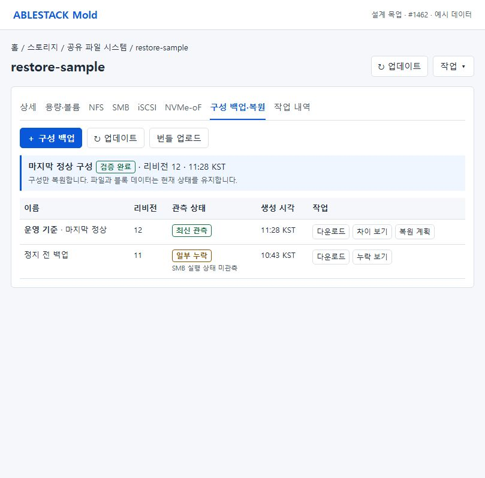
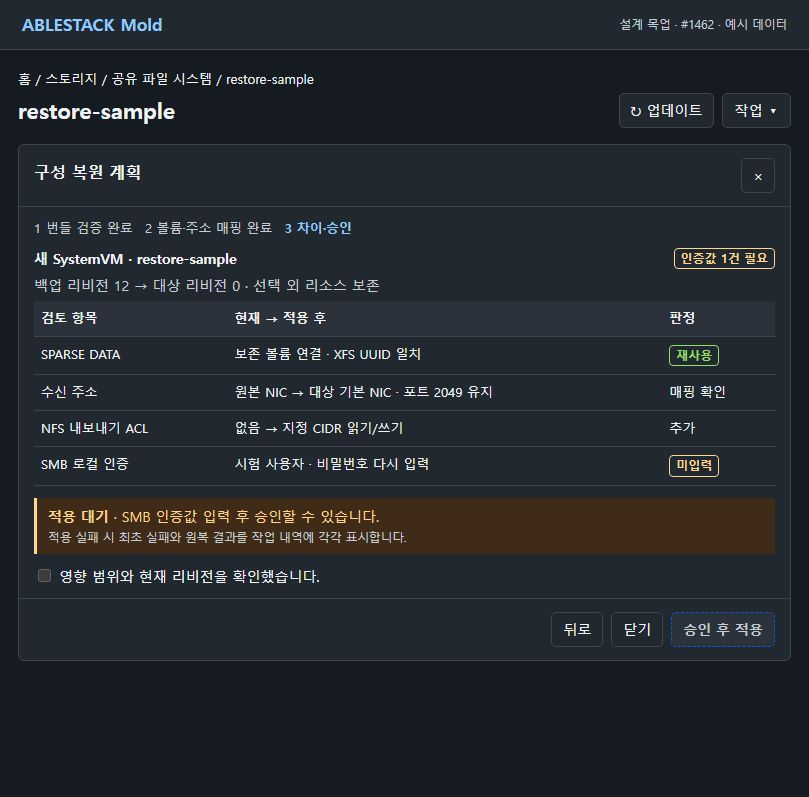

# #1462 SharedFS 구성 백업·복원 설계 — 2026-11-06

**설계 및 격리 시험 기록. 구현·배포·제품 인수는 착수 전이다.** 구성의 원하는 값과 실행 관측을 버전이 있는 번들로 내보낸다. 복원 시 대상의 실제 신원과 설정 차이를 확인한 뒤 기존 구성 트랜잭션으로 적용한다. 파일과 블록 데이터는 그대로 재사용한다.

## 확인한 현재 경계

| 확인 대상 | 관측 |
| --- | --- |
| 소스 | Europa `413d1459682`, Epic `af8236b1ce6194cdb359fa924d5d7e00afb6aa3b`. 로컬 기준과 upstream, Epic과 origin을 각각 0/0으로 확인했다. |
| 13번 관리 서비스 | JAR SHA-256 `d5be6ed5b3d09b928742cf8f8355e48c7824576dc362054812a2fd716dfa8696`. 기존 구성 coordinator 클래스와 preflight·operation 조회 API가 있다. 백업 생성·복원 적용 클래스와 API는 없다. |
| 실제 SharedFS | `epic1438-1460-dual-online-20261105`, Running, 설정 리비전 8, `i-2-214-VM`, 서명 런타임 `1460.client.4`. SPARSE XFS DATA `76827053-fe54-4a8d-a613-ad13bc57580a`, 마운트 UUID `f887b8ec-6601-4bc6-83d7-dba7e247186d`. 실행 중인 대상의 desired 파일은 NFS 1개였다. |
| UI | 실제 VM의 백업 탭은 제목·작업 메뉴, 파란 기본 버튼, 업데이트, 목록과 행 작업을 사용한다. SharedFS 상세에는 프로토콜·런타임·부팅 복구·작업 내역 탭이 있고 구성 백업 탭은 없다. |
| 이전 #909 | 별도 Epic 브랜치의 archive 검증·대상 매핑·정상 지점 승격 시험과 SOURCE 공통 포트 충돌 기록을 설계 참고로 읽었다. 이번 브랜치의 배포·인수 근거는 위 관측을 사용한다. |

## 변경 경계와 코드 접점

| 변경 위치 | 추가·재사용 |
| --- | --- |
| `api/.../storage/dataservice`, `StorageServiceManagerImpl#getCommands` | 구성 번들 목록·생성·전송·검증, 복원 계획·적용, 마지막 정상 지점 조회를 등록한다. 새 API는 기존 SharedFS·계정·프로젝트 접근 검사를 거친다. |
| `server/.../dataservice/StorageConfigArchiveV1`, `StorageConfigArtifactService` (신규) | 엄격한 ZIP/JSON 계약, 원하는 설정과 실행 관측의 허용 필드 투영, 저장·다운로드 권한·수명 관리. 프로토콜마다 별도의 포맷을 만들지 않는다. |
| `StorageConfigRestorePlanner` (신규), `StorageServiceConfigurationPreflight` | 현재 리비전·역할·자원 신원·기능 지원 검사, 명시 매핑·차이·충돌·비밀 슬롯·승인 계획 생성. 네트워크 변경과 실제 중단은 기존 preflight 보호를 적용한다. |
| `StorageServiceConfigurationCoordinator#execute/#resume/#commit`, `StorageServiceConfigurationPlan`, `StorageServiceManagerImpl#applyStorageServiceProtocolDesiredState` | 복원도 동일 instance writer, DAO 계획·예약, 기존 프로토콜 validator/renderer, 적용→검증→커밋과 원복을 사용한다. 복원 어댑터가 현재 테이블에서 승인된 행만 병합해 내부 명령을 만든다. 게스트 입력에 ZIP이나 DB snapshot을 직접 넣지 않는다. |
| `configuration_transaction.py`의 `Transaction`, `RuntimeAdapter#apply/#verify/#observe_completed/#restore` | 기존 QGA envelope에 복원 capability와 계획 digest를 연동한다. 복원 배치에 한해 명령별 결과·신원·관측을 작업 전용 저널에 남긴다. 후속 프로토콜 결과가 앞선 단계의 증거를 덮지 않게 한다. 현재 개별 작업의 반환 계약은 유지한다. |
| `volume_identity.py#resolve_volume_device`, `FileSharePathBindings#volume/#inspect`, `prepareInitialImportedBackingVolume` | 장치 선택 후 실제 파일시스템/블록 신원을 별도로 대조한다. 현재 기존 DATA 준비와 경로 검증을 재사용한다. 복원 진입점에서는 일치하지 않거나 미관측일 때 중단한다. |
| `engine/schema/.../upgrade/dao` | 기존 구성 operation은 그대로 쓰고, artifact 테이블 1개와 DAO를 추가한다. 네 프로토콜 테이블과 일반 VM 백업 기능의 스키마는 변경하지 않는다. |
| `SharedFSTab.vue`, 신규 `StorageConfigBackupTab.vue`·`StorageConfigRestoreDialog.vue` | 구성 백업·복원 탭만 추가한다. 기존 `StorageConfigurationOperationPanel.vue`와 `storageConfigOperation.js`로 작업 추적·원복 진단을 표시한다. |

### 번들·저장·권한

- **ZIP v1** 고정 엔트리 `manifest.json`, `desired.json`, `effective.json`. 매니페스트에 schema, 원본 instance/SharedFS UUID, 리비전, 생성·관측 시각, 프로토콜별 커버리지, 각 엔트리 길이/SHA-256을 기록한다. API는 ZIP 전체 SHA-256과 바이트를 제공한다. 해시는 무결성 검사이며 업로드의 권한·출처 승인과 별개다.
- desired는 공유·대상·ACL, listener 포트/역할, 기본 NIC/별칭 참조, 볼륨 UUID·SPARSE/FAT·용량·FS 타입/UUID·블록 식별자와 지원하는 정책만 타입별로 투영한다. effective는 최신 관측 시각·boot ID·상태·실제 공개 주소/바인딩의 허용 필드를 담는다. 원문 구성, DB ID dump, 파일/블록 내용, 비밀번호, 해시·키탭, CHAP/DH-CHAP 키는 제외한다. `redact()`는 기존 저널에 그대로 두고, 번들에는 명시적 허용 필드와 미지원 필드 누락 보고를 적용한다.
- 기존 인증 POST 전송에 raw 64KiB 조각, 최대 32개, 압축 2MiB 상한을 적용한다. 예약→순서·조각 SHA 확인→완료 SHA 검증 후 `VALIDATED`로 전환한다. 같은 조각/해시 재전송은 같은 상태, 순서·해시 충돌은 거부한다. 다운로드 조각도 매 요청마다 artifact 읽기 권한을 다시 검사한다. 인증·권한 오류와 비밀 입력은 요청/응답 마스킹 정책을 적용한다.
- Commons Compress의 중앙 디렉터리 검사로 허용 엔트리 세 개만 받는다. 절대 경로·역슬래시·상위 경로·디렉터리·중복·symlink·암호화·미지원 method/스키마를 거부한다. 실제 스트리밍 해제 8MiB, 엔트리별 4MiB, 압축비 100:1, JSON 깊이 32 및 컬렉션 한도를 넘으면 즉시 중단한다. UTF-8 오류, 중복 JSON key, 필드 타입·참조 무결성, CRC/길이/SHA 불일치를 검사한다. 디렉터리에 압축을 풀지 않는다. 지원 예산을 초과하는 구성은 명시적 제한으로 보고하고 암묵적으로 잘라 복원하지 않는다.
- `storage_service_config_artifact` 한 테이블에 UUID, 유형 `BACKUP/UPLOAD/RESTORE_PLAN/LKG`, 상태, 원본/대상 UUID, 계정·도메인·프로젝트·Zone, 리비전, 생성자/만료, digest/size, bounded metadata, ZIP용 MEDIUMBLOB을 둔다. 업로드는 짧은 행 잠금으로 조각 상태를 갱신한다. DB packet 한도는 배포 사전 시험에서 2MiB 저장을 확인한다. 만료는 미완료 업로드와 계획에 적용한다. 보존 백업과 최근 정상 지점은 별도 정책으로 다룬다.
- 백업은 원본 제거 후에도 소유 범위에서 열 수 있어야 한다. 원본 FK cascade에 묶지 않고, 계정·프로젝트 소유 범위와 대상·볼륨·Zone 접근을 별도로 확인한다. 원본 삭제 이후 백업 목록/다운로드에는 해당 artifact의 소유 검사가 적용된다. 사용자 입력의 id만으로 다른 계정 리소스를 매핑하지 않는다.
- capture는 DB의 짧은 일관 읽기와 리비전/active writer 확인 → 읽기 전용 게스트 관측 → 리비전·writer·VM/BOOT 재확인 순서다. 진행 중 작업이나 관측 중 변경은 재조회 요구를 반환한다. 정지·오류·접근 불가에서 원하는 값은 저장하되 실행 관측을 `STALE/UNAVAILABLE`로 표시하고 누락·관측 시각을 기록한다. 복원 필수 desired가 누락된 프로토콜은 해당 범위 적용을 차단한다.

### 승인·복원·정상 지점

1. **검증 → 계획.** 같은 서비스와 새 SystemVM 모두 서버가 현재/복원 후 의미 차이를 만든다. 볼륨은 UUID·owner/project·Zone/pool·크기·attach 상태·SPARSE/FAT를 확인하고, guest에서 실제 serial/device와 blkid UUID/type·mount SOURCE/FSROOT를 독립 대조한다. 블록은 FS 없는 것이 허용된 명시 유형이며 정확한 serial·장치·크기/namespace 신원을 요구한다. 같은 크기의 빈 장치 fallback, 자동 attach 대상 대체, 자동 포맷을 허용하지 않는다. 현재 파일 경로의 UUID·inode·bind 검사도 통과해야 한다.
2. **주소·범위.** 원본 listener를 실제 target NIC/별칭에 매핑하고, 동 IP의 NFS·SMB·iSCSI·NVMe-oF 포트를 분리해서 비교한다. 비어 있는 값이 wildcard로 바뀌지 않게 유형을 명시한다. 주소 공유·충돌·DRAIN은 기존 검증 경로에서 판단한다. 계획 밖의 공유·ACL·대상·볼륨은 유지한다. 선택 범위 내 ACL 제거는 diff에 표시하고 별도 확인받는다. 데이터 볼륨 삭제는 복원 API가 아니라 기존 #1461 흐름에서 승인한다.
3. **새 VM.** 업로드/검증 후 UI에서 이 라운드의 원본을 #1461 보존 정책으로 제거하고, 분리 영수증과 보존 DATA UUID를 확인한다. 기존 SharedFS 생성 흐름의 기존 DATA 선택과 `INSPECT_ONLY` 관측, `MOUNT_EXISTING` 준비를 사용한다. 새 SPARSE/FAT ROOT와 새 VM/BOOT가 확인돼야 한다. 마운트 직전 FS UUID 검증은 이 경로에 명시적으로 연결한다. 추가 DATA는 확인된 UUID로 정상 UI 연결한다. 신규/기존 FS 구분과 원래 UUID 대조를 끝내기 전에는 승인된 구성 적용을 시작하지 않는다. 보존 자원과 별도의 ROOT-only 준비가 필요한 경우 기존 생성 준비 저널에 VM·ROOT·DATA allocation을 남겨 같은 자원만 이어간다.
4. **비밀·승인.** SMB 로컬, iSCSI CHAP/상호 CHAP, NVMe-oF DH-CHAP의 재입력 필요 슬롯을 기록한다. 같은 인스턴스에서 변경하지 않는 검증된 계정/credential은 기존 렌더 경로로 재사용할 수 있다. 새 VM의 필요한 값은 적용 직전 입력한다. AD는 공개 구성과 누락을 표시하고 도메인 가입 상태의 복사·자동 가입을 적용 대상으로 삼지 않는다. 필요한 인증이 미해결이면 해당 범위 적용을 차단한다. 비밀은 민감 필드 전송과 기존 보호 QGA/memfd 경로를 사용하고 브라우저 임시 입력은 적용·취소 시 지운다. 기존 보호된 원복 before-image는 export 대상에서 제외한다.
5. **예약 → 적용 → 검증 → 커밋.** 계획 TTL 5분을 초기값으로 둔다. 승인 토큰에는 artifact SHA·계획 digest·대상/BOOT·base revision·실제 매핑·확인한 영향·호출자 scope를 묶는다. UI는 입력 변경 시 승인을 폐기한다. 적용 시 같은 writer lock 하에서 리비전·토큰·매핑/충돌·장치 신원을 재검사하고 논리 requestid를 예약한다. 복원 배치는 기존 네 렌더/검증 함수를 결정된 순서로 호출하고, 각 명령별 결과/검증 digest와 오류를 남긴다. 저장 확정 전 전체 적용 범위의 관측이 필요하다. 예상하지 않은 단계 실패는 기존 before-image로 원복·검증한다. 최초 오류와 원복 결과는 분리한다. timeout/BOOT 변경/관측 유실은 `RECOVERY_REQUIRED`로 같은 요청을 관측한다. 자동 재전송, 재포맷, 암묵적 복원을 허용하지 않는다.
6. **마지막 정상 구성.** 현재 coordinator의 개별 수동 변경과 복원 둘 다 공통 완료 훅으로 연결한다. SQL이 커밋됐고 같은 revision/BOOT의 guest commit 및 활성 프로토콜 검증을 확인한 뒤에만 LKG artifact를 생성한다. 활성 지점은 instance lock과 유일 슬롯으로 보호하고, 후보 쓰기·이전 지점 보존·현재 슬롯 이동을 한 DB 트랜잭션으로 처리한다. 파일 구성 일부 누락·실패·원복·timeout·대상 없는 SQL-only 커밋에서는 기존 지점을 유지한다. guest ACK 유실 시 후속 읽기 전용 관측으로만 승격을 확인한다. 과거 지점의 수동 복원은 일반 diff·승인 계획을 다시 사용한다.

## SystemVM 주입 시험

기존 SPARSE 서비스의 실행 중인 **`1460.client.4` 코드**를 임시 작업 디렉터리에서 로드했다. 실제 장치와 마운트는 읽기 전용으로 관측했고, 트랜잭션 효과만 합성 상태와 두 번째 프로토콜 실패 주입으로 대체했다. 이 시험에서 실제 공유·디스크를 생성·설정·포맷하지 않았다.

| 시험 | 결과와 설계 반영 |
| --- | --- |
| 실제 XFS DATA 시리얼·UUID 관측 | `/dev/sdb`를 올바르게 선택했고 매핑 없는 요청은 거부했다. 시리얼이 맞고 요청 FS UUID가 틀려도 현 함수가 같은 장치를 반환함을 재현했다. 따라서 선택 결과만으로 승인하지 않고 실제 FS UUID/type을 별도로 비교한다. |
| 실제 Transaction과 RuntimeAdapter 적용 순서 | NFS 역할의 첫 단계 성공 후 SMB 역할의 두 번째 단계에 합성 실패를 주입했다. `ROLLED_BACK/SUCCEEDED`, 최초 원인 유지, 임시 before-image의 정확한 복구와 합성 데이터 보존을 확인했다. 동일 request 재실행은 새 apply를 시작하지 않았다. |
| 저널·리비전 | `VERIFIED`에서 리비전이 갱신되지 않고 `COMMITTED` 후 1로 진행했다. 오래된 base revision은 거부했다. 합성 비밀번호 제외, 디렉터리 0700/파일 0600을 확인했다. |
| 배치 증거 | 비활성 명령 두 개의 임시 후보와 마지막 runner 성공 파일 하나로 현 verify 경계가 통과했다. 따라서 복원은 명령별 적용·관측 결과를 각각 보관하고 모두 검증해야 한다. |
| 운영 상태 보존 | 실제 desired 파일 해시가 시험 전후 일치했다. |

[관측 원문](observations.json). 이 증거는 현재 경계의 실증이며 새 API·ZIP 구현·네 프로토콜 실제 복원 인수는 이후 단계다.

## UI 목업과 인수 순서

VM 백업 탭의 헤더·탭·버튼·테이블 밀도를 따라 구성 백업·복원을 한 탭에 둔다. 목록은 관측 상태와 시각, 누락 내용, 마지막 정상 지점, 다운로드/차이/복원 계획을 표시한다. 검토창은 단계·대상·매핑·diff·미입력 사유를 텍스트로 제공하고 확인 버튼은 준비될 때만 활성화한다. 구현 시 기존 Mold 대화상자의 고정 헤더·푸터, 토큰 기반 다크 모드와 키보드 탐색을 재사용한다.

1. 모듈 시험에서 악성 ZIP·미지원 스키마, 권한 없는 읽기/계획/적용, wrong UUID, 미해결 인증, stale revision·동시 writer와 LKG 지연/재시작을 확인한다.
2. 13번의 이번 라운드 새 SPARSE 이상 원본/클라이언트로 NFS, SMB 로컬, iSCSI, NVMe-oF 단독 UI 백업→다운로드→변경→업로드→검토→동일 서비스 복원을 각각 확인한다. 적용 전·후 설정과 포트, 클라이언트 인증·읽기·쓰기·checksum을 대조한다.
3. 네 프로토콜 통합 서비스에서 동시에 I/O하고, 백업 후 추가한 데이터·계획 외 리소스를 기록한다. 같은 서비스 복원을 검증한 뒤 UI에서 원본을 제거하고 분리 영수증을 확인한다. 이번 DATA를 새 VM/새 ROOT에 연결해 다시 UI로 복원한다.
4. 변경 실패와 원복을 별도로 관측한다. 마지막 정상 지점의 성공 시 이동·실패 시 이전 유지·수동 diff/복원, 관리 서버 및 SystemVM 재시작 후 같은 이력을 확인한다. 제품 오류가 확인되면 추가 변이를 중단하고 최초 진단을 남긴다.
