<!--
Licensed to the Apache Software Foundation (ASF) under one
or more contributor license agreements.  See the NOTICE file
distributed with this work for additional information
regarding copyright ownership.  The ASF licenses this file
to you under the Apache License, Version 2.0 (the
"License"); you may not use this file except in compliance
with the License.  You may obtain a copy of the License at

  http://www.apache.org/licenses/LICENSE-2.0

Unless required by applicable law or agreed to in writing,
software distributed under the License is distributed on an
"AS IS" BASIS, WITHOUT WARRANTIES OR CONDITIONS OF ANY
KIND, either express or implied.  See the License for the
specific language governing permissions and limitations
under the License.
 -->

# 템플릿 상세 탭 UI 재점검·수정 설계

2026-11-14 KST / 13번 클러스터 / 실제 admin UI 관측 / 소스 기준 `b8c8300a6303265f364f30c9f4992e8a8671a7e6`.

**이번 단계는 점검·개선 방향·이슈 등록까지다. 제품 코드 수정이나 배포는 수행하지 않았다.** 사용자가 명칭·순서 변경도 이번에는 이슈의 확정 요구사항으로 반영하도록 확인했다.

## 판단 교정과 비교 기준

이전 Epic #1638 / PR #1647에서 공통 프레임·기능·긴 값 표시를 확인한 결과를 탭 콘텐츠 배치의 표준화 완료로 확대했던 판단을 교정한다. 이번에는 실제 VM의 **설정과 NIC 탭 내부 배치**를 템플릿의 Zone·설정·VNF와 직접 비교했다. 정보 카드+세로 탭이라는 공통 외곽 구조를 재사용해도 내부 도구 모음·데이터 표시·행 작업·페이지 처리가 같지는 않다.

| 구분 | 실제 VM 기준 | 현재 템플릿 | 개선 방향 |
|---|---|---|---|
| 상단 도구 모음 | 추가/연결·새로고침 왼쪽, 검색 오른쪽 | Zone은 없음, 설정/VNF는 전체 폭 점선 추가 버튼 | 같은 배치·크기·간격의 도구 모음, 기능별 필요한 작업만 노출 |
| 설정 본문 | 이름/값/변경 가능 여부/작업 표 | 이름 제목+아래 값의 개별 목록·원형 아이콘 | VM 설정과 같은 목록형 표·행 작업, 권한/변경 불가 상태 명시 |
| VNF 본문 | VM NIC의 표·도구 모음 기준 | NIC는 표, 속성은 별도 목록, 구분선·전체 폭 추가 버튼 반복 | NIC·속성을 같은 섹션 규칙으로 구성, 속성도 이름/값/작업 정렬 |
| Zone 선택 | 표 도구 모음과 행 작업의 위치가 일정 | 선택 시 전체 폭 빨간 삭제 버튼이 생겨 표가47px 이동 | 고정 도구 모음 안에 선택 작업 배치, 높이·표 시작점 안정화 |
| Zone 펼침 | 어두운 구분선과 테마 표 규칙 | Primary/Secondary를 밝은 테두리 표2개로 붙임 | 명확한 두 하위 영역, 공통 표·상태·진행률 표시·내부 스크롤 |
| 좁은 화면 | 표 최소 폭과 내부 가로 스크롤 | 1024px Zone 이름·시간·준비 헤더/행 작업이 여러 줄 | 주요 이름 우선 폭, 보조 값 생략/tooltip, 표 내부 스크롤/행 작업 정리 |

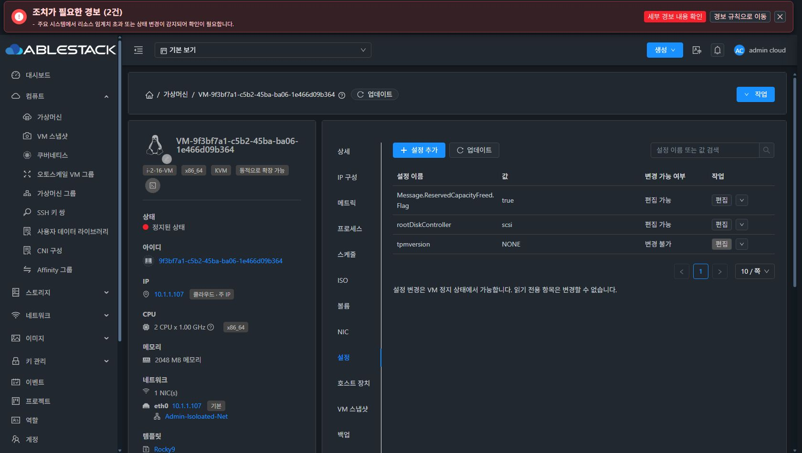

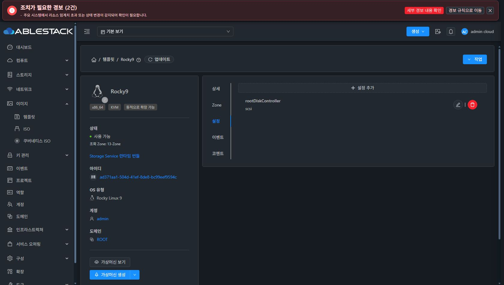

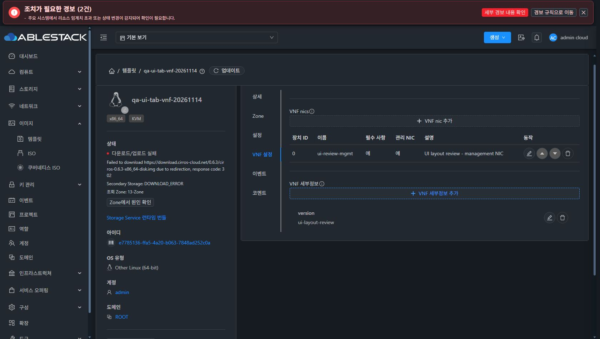

## Zone 다크 고대비 확인

실제 computed style에서 VM 설정 표의 수평 구분선은 `rgb(67,67,67)` /1px solid다. Zone 펼침 표는 같은 어두운 배경 `rgb(34,40,47)`에서 **세로선만 `rgb(240,240,240)` /1px solid**로 남았다. 라이트 모드의 같은 세로선 값도240이며, 다크에서 밝은 격자선이 과도하게 두드러진다. 이는 글자 대비 부족이라는 판정과 구분한다.

[실제 색상·테두리 폭](evidence/observations.json)에 VM/Zone 다크·Zone 라이트를 함께 저장했다. `TemplateZones.vue`의 두 `bordered` 하위 표와 공통 테마 규칙의 적용 범위를 확인해야 한다. 전역 CSS로 다른 표를 바꾸지 않고 템플릿 범위에서 테마 토큰을 일관되게 적용하는 방향이 적절하다. 기본·펼침·선택·hover·disabled·focus의 색상 체계를 함께 수용 검사에 넣는다.

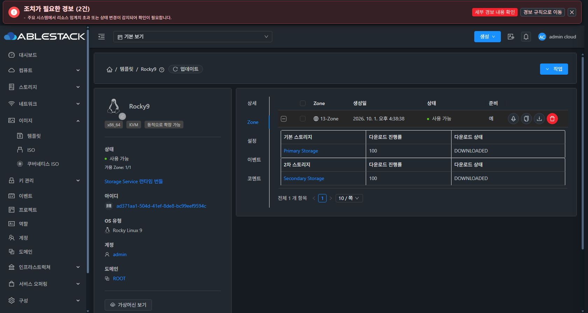

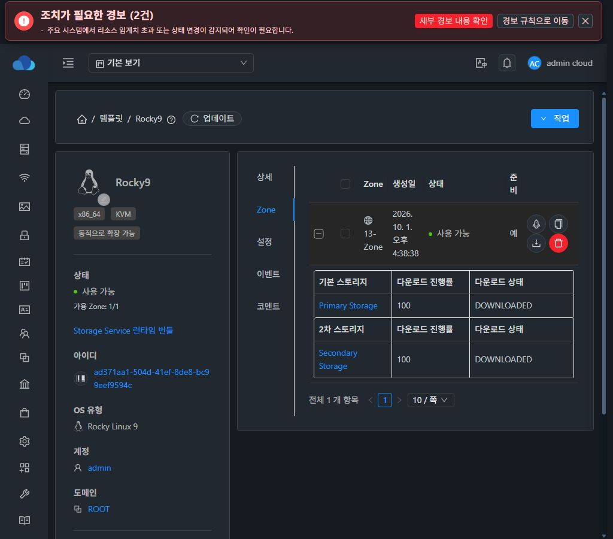

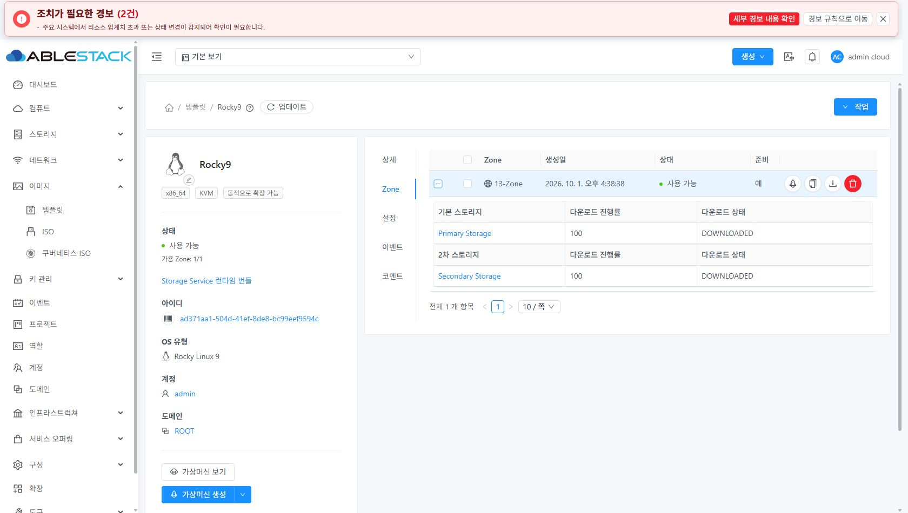

## 탭 명칭·순서 확정 요구사항

| 유형 | 목표 순서 |
|---|---|
| USER/SYSTEM | 상세 → Zone → 설정 → 이벤트 → 코멘트 |
| VNF | 상세 → Zone → 설정 → VNF 설정 → 이벤트 → 코멘트 |
| SHAREDFS | 상세 → Zone → 설정 → 런타임 번들 → 이벤트 → 코멘트 |

현재 SHAREDFS는 `상세 → Storage Service 런타임 번들 → Zone → 설정 → 이벤트 → 코멘트`다. **SHAREDFS 탭 표시 이름을 런타임 번들로 줄이고 설정 다음으로 이동한다.** 조건부 부가 탭은 유형·권한에 따라 표시하되 빈 탭이나 임의의 순서 변화를 만들지 않는다. 기존 `runtime.catalog` 식별자·딥링크·API·전역 도구 메뉴의 명칭은 별도로 유지한다.

현재1680px에서 USER 탭 레일71px/본문853px, SHAREDFS 레일199px/본문725px였다.1024px에서는 같은 조건의 USER 본문475px에 비해 SHAREDFS 본문347px로 줄었다. 긴 탭 이름이 본문 폭을128px 더 소모한다. 각 탭의 데이터 양과 별개로 측정한 가로 배치 근거다.

런타임 번들 본문은 전역 카탈로그를 읽는 화면이다. 그 목록을 현재 템플릿에 설치됐거나 호환성 검증된 번들로 오인시키지 않아야 한다. 대상별 관측 근거가 없으면 UNKNOWN 의미를 유지하고, 큰 상시 설명 박스 대신 필요한 범위/상태를 간결하게 구분한다.

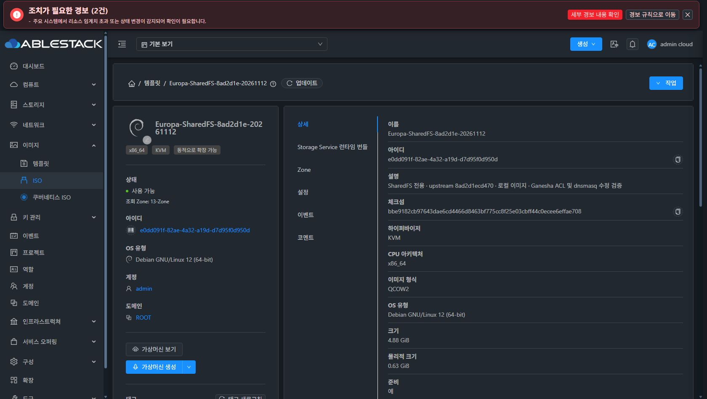

## 생성·수정 대화상자 SHAREDFS 정합성

| 흐름 | 실제 UI 관측 | 소스상의 서버 정책 | 수정 설계 |
|---|---|---|---|
| URL 등록 초기 | USER/VNF/SYSTEM/BUILTIN/ROUTING, SHAREDFS 없음 | 조건 충족 시 SHAREDFS 신규 등록 지원 | 생성 진입 시 지원 유형과 전제 조건을 예측 가능하게 표시 |
| URL 등록,13-Zone·KVM 선택 후 | SHAREDFS가 추가됨 | Root 소유·KVM·명시 Zone·x86_64·QCOW2·private/downloaded·동적 확장 등 요구 | 해당 프로필 값을 선택 단계에서 검증/표시하고 마지막 제출 오류로 미루지 않음 |
| 로컬 업로드,13-Zone·KVM | SHAREDFS도 선택지에 나타남 | 현재 GetUploadParamsForTemplateCmd의 SHAREDFS는 허용하지 않음 | 지원하지 않는 선택지를 전송하지 않음. URL 등록 진입을 짧게 안내. 로컬 지원 확장은 별도 backend 요구로 구분 |
| 기존 USER KVM 수정 | SHAREDFS가 선택지에 나타남 | 일반 유형→SHAREDFS 전환 금지, 신규 등록 필요 | 전환 불가 유형은 제공하지 않거나 이유와 함께 비활성 |
| 기존 SHAREDFS 수정 | USER/VNF 등 다른 유형도 나타남 | SHAREDFS 유형·이미지 프로필 불변 | 현재 유형은 읽기 전용으로 보존하고 허용된 필드만 수정 |

생성에서 SHAREDFS가 영구적으로 빠졌다고 단정하지 않는다. **초기 발견성/조건 안내와 생성·수정별 허용 정책의 불일치**가 확인된 문제다. 기존 USER/SHAREDFS는 수정 대화상자를 열고 선택지를 확인한 뒤 취소했으며 변경 요청을 제출하지 않았다. 서버 거부를 실계정으로 실행한 결과가 아니라 아래 기준 소스로 확인한 정책임을 명시한다.

URL 신규 등록 조건의 상세 근거:

- TemplateManagerImpl.validateTemplateType: 관리자, KVM, cross-zone 아님. 현재 로컬 업로드는 허용 대상 명령에 없음.
- TemplateAdapterBase.prepare(RegisterTemplateCmd): 호출자·소유자가 Root, x86_64/amd64, QCOW2, dynamic scaling=true, public/featured/extractable/directdownload=false.
- TemplateManagerImpl.updateTemplate: 기존 비SHAREDFS를 SHAREDFS로 전환할 수 없고, 기존 SHAREDFS의 유형/arch/format 변경을 차단.
- imagesUtilPlugin의 공통 목록은 hypervisor와 역할/API만으로 SHAREDFS를 추가한다. URL/업로드/수정 및 원래 유형을 구분하지 않아 정책 차이가 UI에 반영되지 않는다.
- 등록 초기에는 `$fetchTemplateTypes()`를 인자 없이 호출하고 KVM 선택 뒤 다시 계산하지만 수정은 기존 KVM을 바로 전달한다. 이것이 두 대화상자의 초기 목록 차이를 설명한다.

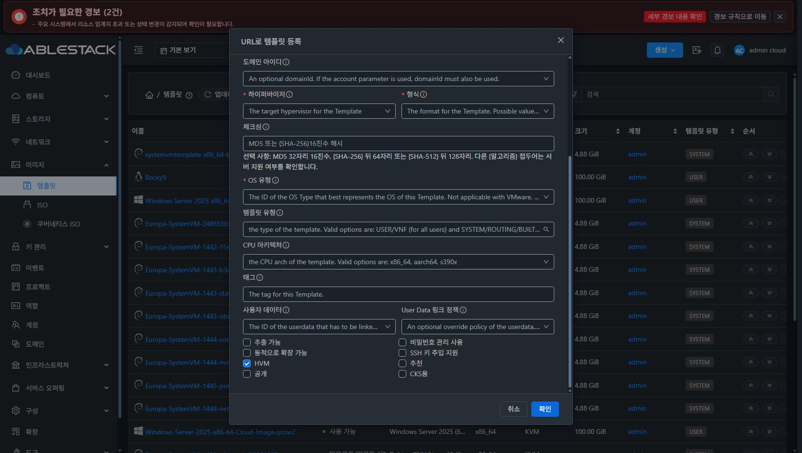

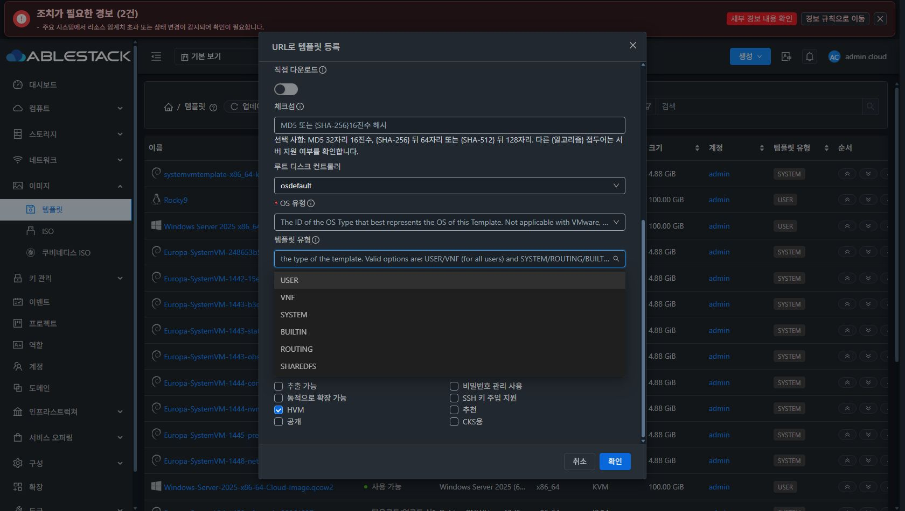

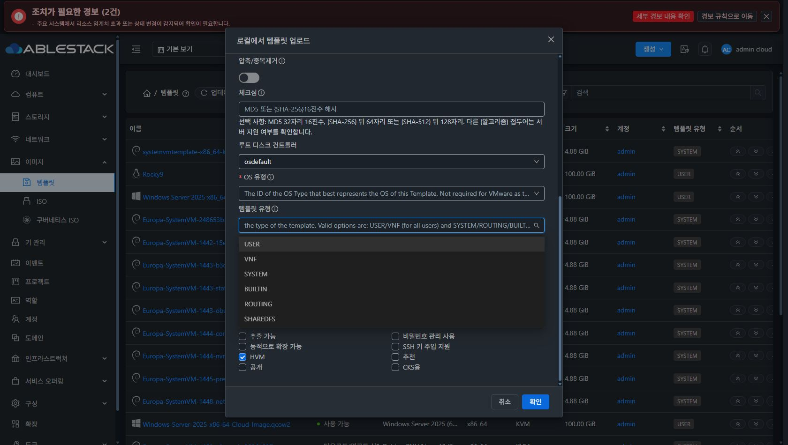

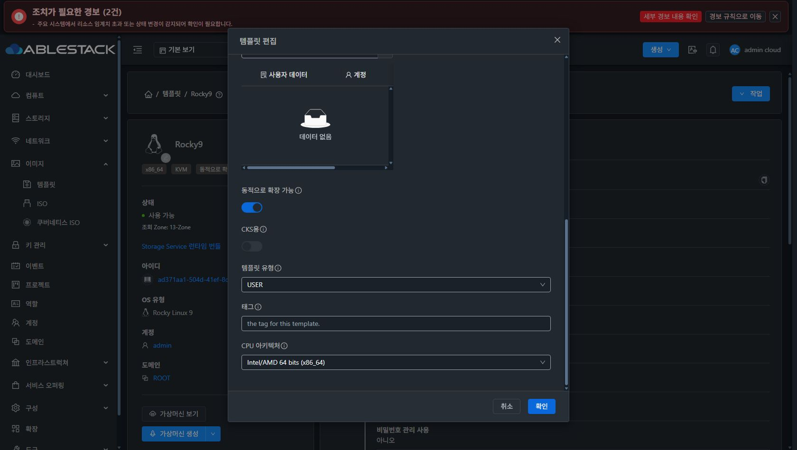

## 수정 책임과 개발 순서

1. 표시 이름·탭 순서를 먼저 고정하고 유형/권한에 따른 기대 탭 배열을 검사한다.
2. Zone의 다크 테두리·확장 영역·선택 도구 모음·좁은 화면 표를 교정한다.
3. 템플릿 설정과 VNF에 VM 기준의 도구 모음·표·행 작업·페이지/빈/오류 상태 규칙을 적용한다. 테이블을 표시하는 일과 각 자원의 쓰기 API/권한 정책은 분리한다.
4. 생성·수정의 유형 선택 정책은 별도 이슈에서 다룬다. URL/업로드/수정과 원본 유형을 입력으로 받는 공통 정책 함수를 설계하고 서버가 최종 검증을 유지한다.

초점·ESC·키보드/스크린리더 이름·초안·비밀 값·부분 실패·중복 제출 방지·개별 Zone 결과 보존과 실제 ACL은 기존 계약을 유지한다. UI 표준화 때문에 VM 정지 조건을 템플릿에 복사하거나 서버 권한을 넓히지 않는다.

## 점검 범위와 자원 정리

1680/1024px 및 VNF390px의 실제 UI, 다크 VM/템플릿 설정·Zone·VNF·SHAREDFS와 라이트 Zone을 비교했다. 향후 구현 수용 검사는3개 너비×양 테마의 모든 대상 탭과 권한별 제어를 확인해야 한다. 오늘의 표본 관측을 전체 회귀 통과로 표현하지 않는다.

VNF는 점검용 `qa-ui-tab-vnf-20261114` / `e7785136-ffa5-4a20-b063-7848ad252c0a`를 UI에서 등록해 빈 상태 및 NIC1개·version1개가 있는 상태를 확인했다. 이미지 다운로드는302 리다이렉션으로 DOWNLOAD_ERROR가 됐으며 Ready/부팅 검증에 사용하지 않았다. 화면 배치 점검만을 위한 샘플이다. 일반 삭제 job `8d66ddfd-0677-48b0-aa40-2bbe2b805cb9` status1/success=true, 목록46개 복원을 확인했다. [시험 자원](evidence/test-resource.json)

기존 VM/USER/SHAREDFS는 읽기/선택/대화상자 취소만 수행했다. 기존 다크 모드와 기본 뷰포트를 복원했다. 제품·백엔드·DB·host/SSVM 코드 수정과 배포는 없으며 기존 CI 부채 #926/#1044도 별도 유지한다.
