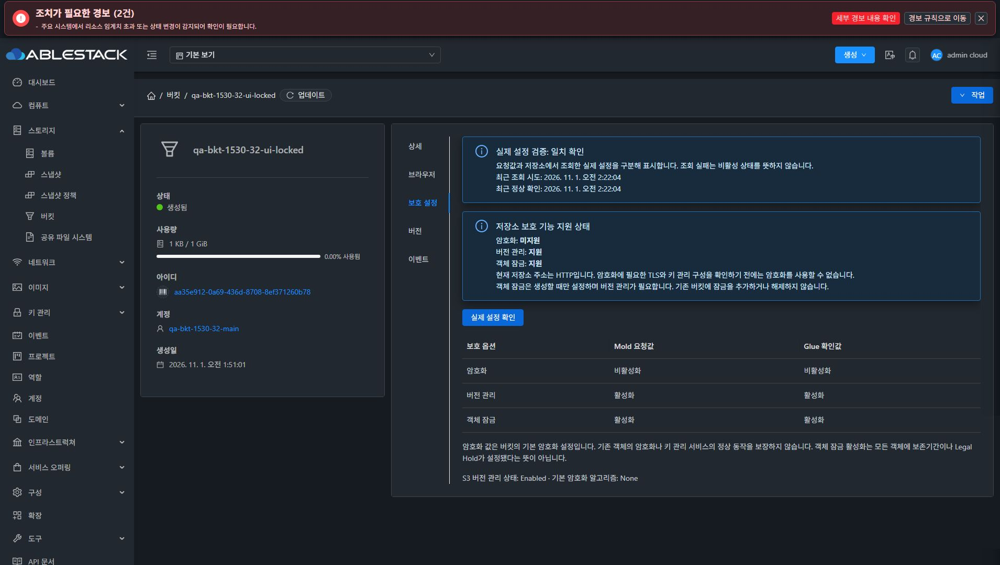
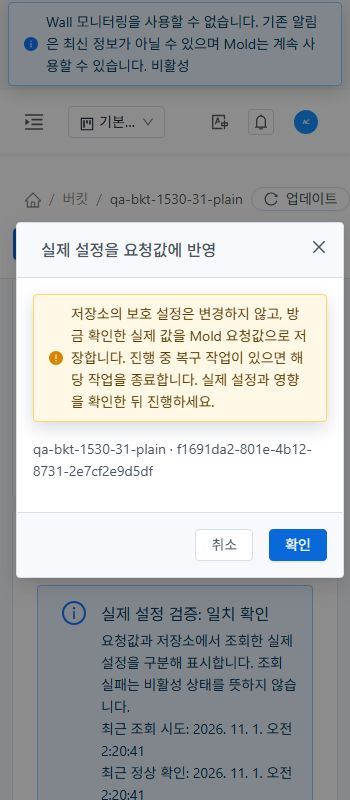

# #1530 보호 설정 구현·배포·UI/Glue 검증

같은 `dhslove/epic-1527-buckets` 브랜치에서 요청값을 실제 적용 결과처럼 표시하던 문제를 수정했다. 버킷 생성·변경은 실제 Glue 설정을 다시 확인한 뒤 확정한다. 조회 불가/불일치/복구 대기를 구분하고, 객체 잠금의 생성 시 제약과 명시적 복구를 제공한다. [최종 설계](../../design/bucket-1527/1530-protection-consistency.ko.md) · [Epic #1527](https://github.com/ablecloud-team/ablestack-cloud/issues/1527) · [PR #1541](https://github.com/ablecloud-team/ablestack-cloud/pull/1541).

## 실제 적용과 표시 결과

| 항목 | 31 GFS2 / 32 RBD에서 확인한 결과 |
|---|---|
| 실제 저장소 | 두 Mold 모두 32번 Glue RGW 사용. GFS2/RBD는 bucket data provider를 뜻하지 않는다. |
| 암호화 | 현재 HTTP endpoint는 Unsupported. 생성/수정 preflight 거부, UI switch 비활성. 실제 AES256 암호화 PUT은 HTTP 400 InvalidRequest이며 plaintext 객체가 생기지 않았다. |
| 객체 잠금 | 실제 UI로 전용 잠금 버킷을 생성. DB/UI/Glue의 lock+versioning 모두 true/Enabled. COMPLIANCE retention 및 Legal Hold가 있는 정확한 버전 삭제는 403. 중단/잠금 변경 요청은 backend가 원장 생성 전에 거부. |
| 실제 설정 표시 | requested/effective 값·조회/확인 시각·operation UUID·Verified/Mismatch/Unknown을 구분. 실제 조회 실패를 false로 바꾸지 않는다. |
| legacy 불일치 | 전용 QA의 요청값 true와 실제 false를 Mismatch로 유지. 두 UI에서 명시적으로 실제값 수용 후 Verified. 실제 설정·원래 파일 내용은 그대로 보존. |
| 수정 직후 갱신 | 열린 보호 탭이 이전 값을 유지하던 결함을 실측 후 수정. 최종 bundle에서 UI 수정 완료 직후 자동 조회하여 요청/실제 값 일치. 탭 재접속/수동 새로고침 없이 양쪽 검증. |

현재 환경에서 암호화 기능을 성공으로 제공하지 않는 것이 검증 결과다. HTTPS/KMS 준비·실제 암호화 객체 쓰기 성공은 검증하지 않았으며 capability Unknown으로 남긴다. 기본 암호화는 기존 객체 암호화 보증이 아니고, lock 활성화도 모든 객체의 retention/Legal Hold 보증이 아니다. 해당 범위 안내를 화면에 표시했다.

## 실패와 복구

- 두 클러스터 owner 허용/타 계정 거부, POST/no-store 및 GET 400, unsupported encryption·lock 선행 조건·기존 lock 변경 거부를 확인했다. 거부 시 신규 bucket/예약/원장이 생기지 않았다.
- 실제 S3 policy로 GetBucketVersioning을 거부해 Unknown 및 실효 boolean 누락을 확인했다. 원래 policy를 정확히 복원한 뒤 Verified로 회복했다. loopback 전용 QA proxy를 통해 실제 SDK 약 25초 timeout과 retry도 양쪽 확인했다. UI의 timeout 안내·Unknown 표·실제 설정 재확인도 확인했다.
- 31 UI 변경 후 QA UUID에만 적용한 DB commit 실패 trigger로 최초 Off→Enabled 뒤 보상 Suspended를 재현했다. 정확한 Off 복원은 불가능하므로 NeedsReconcile과 원래 false 요청값을 유지했다. quota/policy/일반 삭제와 UI upload/folder/선택 삭제가 제한되며 파일 목록 읽기는 끝났다. trigger 제거 후 UI에서 실제 상태를 명시적으로 수용해 해제했다. 수동 counter/원장 보정은 사용하지 않았다.
- 31 UI 변경 후 S3 적용은 성공하되 확인/복구 조회를 실패시켰다. NeedsReconcile·동일 UUID·Mismatch를 유지했고 장애 해제 후 UI 명시적 복원으로 원래 Suspended 상태를 회복했다.
- 32는 실제 S3 PUT 200 및 원장 Applying 체크포인트에서 Mold를 정상 중지·재시작했다. 정상 중지 완료 시 이미 NeedsReconcile이었으며, 재시작 후 같은 UUID와 실제 Enabled/requested false를 유지했다. UI 명시적 복원으로 원래 Suspended를 회복했다. 이 결과는 강제 종료나 Applying 상태의 crash-replay 실측으로 주장하지 않는다. worker 미완료 복구 계약은 단위 회귀에 포함했다.
- 양쪽 복원 완료 후 같은 UUID를 3회씩 재전송해 추가 provider PUT·원장 생성이 없고 원래 파일 SHA256이 유지됨을 확인했다. provider false/예외·외부 변경·DB 실패와 복구 실패 경계는 backend 회귀도 확인했다.

실측 중 발견한 DAO entity update의 CGLIB 계약 위반과 열린 탭의 이전 확인값 잔존은 수정·재배포 후 양성 경로와 회귀를 통과했다. 최초 실패 시 생성한 QA 객체를 성공으로 집계하지 않았다.

## UI 표준과 화면 증거

최종 bundle에서 양쪽 라이트/다크 360·768·1280px을 확인했다. 실제 DOM computed color의 alpha를 배경에 합성해 대비를 계산했다. 활성 텍스트 미달 0건, root 수평 넘침 0건. 최저 라이트 5.19:1 / 다크 5.19:1. VM 메뉴의 32px/14px 조작, 공통 대화상자와 theme token, label-for 연결을 확인했다. 좁은 표는 내부 560px 가로 스크롤이며 전체 화면을 넓히지 않는다. 실제 표/확인값으로 스크롤한 뒤 캡처했다.

JPEG 원본을 편집하지 않았다. CSS viewport와 native capture의 실제 pixel 치수는 다를 수 있으며 JSON의 viewport와 decoded dimensions를 별도 기록했다. 과거 r2 UI에서 수행한 생성/legacy 수용/timeout/복원 이력은 source를 구분하고, 최종 갱신/반응형 증거는 최종 bundle로 확인했다.

## 빌드·배포

- WSL ext4에서 api, engine/api, engine/schema, engine/storage 계약과 server, Ceph 변경 모듈만 빌드. backend 150건(server 92/Ceph 58)·Java 30개 Checkstyle 통과.
- UI 8 suites/111건 통과, 마지막 scope guard 변경 후 보호 화면 12건 재검증. 변경 UI lint·production build 통과. 전체 Cloud/Full CI·GitHub Actions·qemu 빌드는 실행하지 않았다. 기존 경고와 등록된 GitHub checks 부재를 전체 CI 성공으로 바꾸지 않는다.
- backend 배포 source `b1ef33b1c8f6210eb8cb3f90e631eb901c6fa71f`, 최종 UI source `ff7b81ef4b74171ccf4d82558f01257859ba1f70`. 그 이후 변경이 문서뿐인지 source hash로 확인한다. 현재 PR head는 GitHub 최종 상태에서 확인한다.
- 양쪽 실행 JAR SHA256 `61372c77d39bd95c503c89eaf99152db8b7fd4d56ad20a4eb7974bb0852b5093`. 원래 #1532 JAR의 zip records를 보존하고 변경 module classes/schema만 overlay했다. additive snapshot DDL을 재실행 가능하게 적용했다.
- 정적 파일 638개 hash 및 index `1e3c0aec0a74bab4f31cdce02d4c07096fb420f89889456a0cba1be1d65702e8` 양쪽 일치. WEB-INF·설정·정적 배포 당시 PID와 9개 실행 라이브러리를 보존. `/client/` HTTP200, Mold active, routing host 각3대 Up, Glue HEALTH_OK/RGW3/3.
- 31 `/var/tmp`, 32 `/nfs`에 이전 실행 JAR·변경 정적 파일 backup을 유지했다. active webapp root를 교체/삭제하지 않았다. 32 루트 잔여 공간은 final-health에 실측 기록하고 무관한 데이터는 지우지 않았다.

## 정리와 유지 자원

전용 QA bucket10개/store6개/account4개를 만들었다. QA lock의 retention 만료를 확인한 뒤 해당 버전 Legal Hold를 해제하고 버전·marker를 정확히 지워 Cloud empty-only 일반 삭제로 정리했다. quota counter 수동 수정 없이 계정·store 사용량 0, credential rows/예약/미완료 작업/trigger 0을 확인했다. 두 임시 proxy를 중지하고 QA RGW 사용자/키를 정리했다. 새 시험 키 12개 값의 현재 management log·검증 기간 journal 노출 0건이며 공개 source·증거·본문의 키/비밀번호 검사도 수행했다. Windows/WSL의 기존 FT 작업본 HEAD/diff/상태와 WSL의 기존 untracked hash를 보존했다.

**확인용 `qa-bkt-1540-32-files` 하나와 원래 11개 객체·계정 상세·키·요청/실제 보호 설정을 유지했다.** [Mold 브라우저](http://10.10.32.10:8080/client/#/buckets/3e952d59-a311-4a2b-86fe-d66ed38f050c?tab=browser). 최종 UI의 root8행은 폴더를 포함한 목록이고 raw S3 실제 객체는11개다. 원시 byte SHA256으로 전부 비교했다.

다음 작업은 OPEN P2 **[#1534 Object Store UUID 버킷 필터·소속 버킷 조회](https://github.com/ablecloud-team/ablestack-cloud/issues/1534)**이다. Epic은7/13 완료·OPEN, PR1541은 미병합으로 유지한다.
