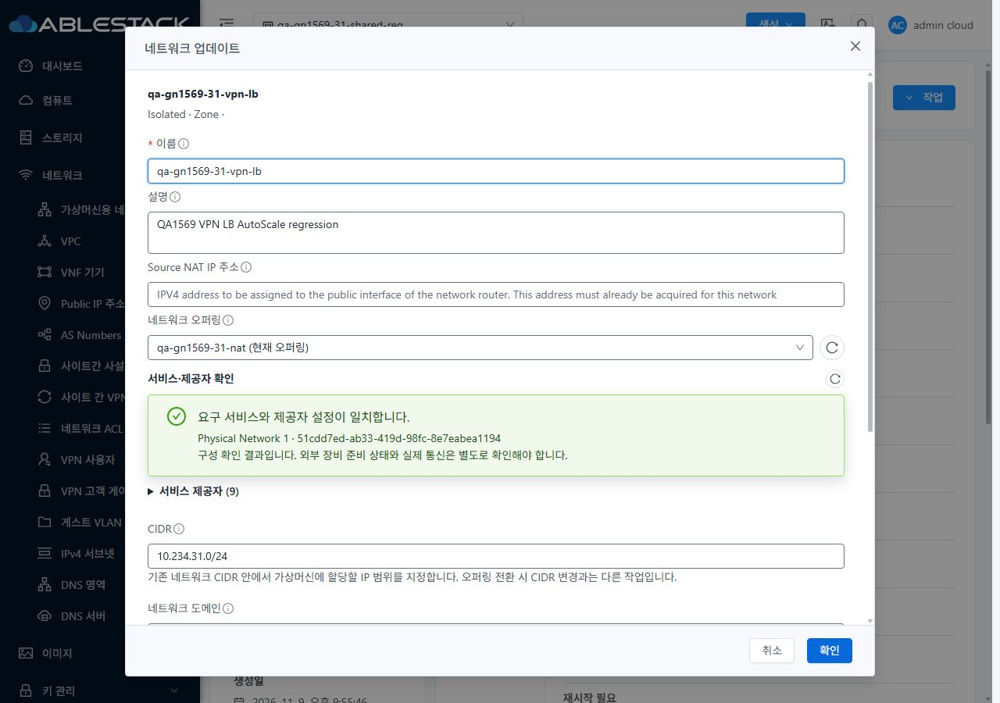
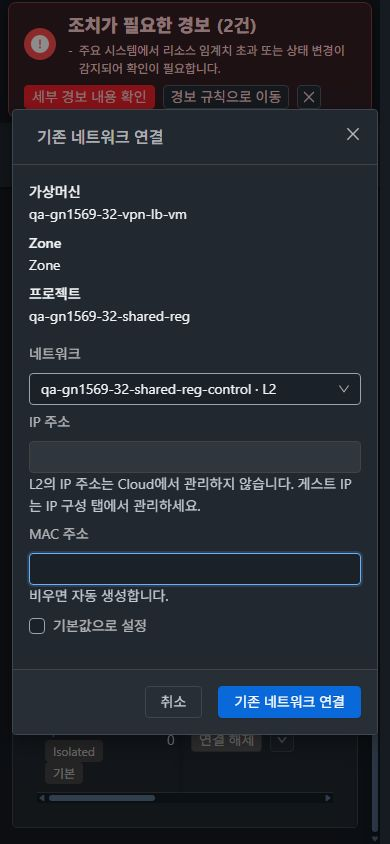

<!--
Licensed to the Apache Software Foundation (ASF) under one
or more contributor license agreements.  See the NOTICE file
distributed with this work for additional information
regarding copyright ownership.  The ASF licenses this file
to you under the Apache License, Version 2.0 (the
"License"); you may not use this file except in compliance
with the License.  You may obtain a copy of the License at

  http://www.apache.org/licenses/LICENSE-2.0

Unless required by applicable law or agreed to in writing,
software distributed under the License is distributed on an
"AS IS" BASIS, WITHOUT WARRANTIES OR CONDITIONS OF ANY
KIND, either express or implied.  See the License for the
specific language governing permissions and limitations
under the License.
 -->

# 병합본 8ad2d1e 빌드·31/32 배포·회귀 검증

2026-11-12. 병합 커밋 `8ad2d1ecd47092fd3bba8d445fd2c639c7f4be7c`의 변경 모듈과 UI를 WSL ext4에서 새로 빌드하고, 31(GFS2)·32(Glue RBD) 관리 서버와 호스트 6대에 반영했다. 최신 회귀 자원으로 API·브라우저 UI·실제 패킷과 게스트 NIC를 검증했다. 이번 변경은 **배포 및 증적 추가**이며 제품 소스 수정은 없다.

- [빌드·배포 범위와 해시](deployment.ko.md)
- [API·실제 통신·UI 결과 및 판정 한계](validation.ko.md)
- [원본 캡처와 화면별 확인 항목](capture-matrix.ko.md)
- [남겨둔 최신 시험 자원](retained-resources.ko.md)

| 항목 | 결과 |
| --- | --- |
| 변경 JAR 모듈 6개 | 로컬 clean install 성공 |
| SystemVM·Tools 선택 모듈 | 로컬 package 성공; 공통 agent.zip·scripts 반영 |
| 집중 Java 회귀 | 이번 실행 10 suites, **226/226**, 실패/오류/skip 0 |
| UI | 새 production build 성공; **689개 파일**, 양쪽 해시 불일치 0 |
| 관리 서버 / 호스트 | 2대 mold / 6대 mold-agent active, Cloud 호스트 전부 Up |
| 역할 계약·프로젝트 조회 | 9역할 계약 + 54 메타데이터 조회 + Shared IP/NIC 3건, **66건/사이트** |
| UI 실제 변경 | 설명 수정·NIC 연결·해제 각 사이트 성공 job 3개, 총 6개 |
| 실제 통신 | Shared DNS UDP/TCP·DHCP DORA/갱신·ICMP/SSH, VPN, TLS·HAProxy 통과 |
| 자원 보존 | VM **29**, 네트워크 **32**, VPC **6** 및 기존 NIC 보존 |

VM 메뉴의 목록·상세·세로 탭·대화상자·breadcrumb·모바일 테마와 대조했다. 네트워크 탭의 상단 작업 영역, 아이콘+텍스트 업데이트, 세로 입력, 오퍼링 선택 우측의 아이콘 조회, NIC 진행/완료 대화상자와 기본 NIC 보호를 확인했다. 390/768/1280 및 1600 확대, 즉시 테마·프로젝트 왕복·새로고침 전후 스크롤도 확인했다. 표의 좁은 헤더와 VM 목록의 기존 선택 항목 링크는 별도 P3 표시 개선 후보로 구분했다.

[PR #1577](https://github.com/ablecloud-team/ablestack-cloud/pull/1577)은 병합 상태를 유지한다. [#1569](https://github.com/ablecloud-team/ablestack-cloud/issues/1569)·[Epic #1554](https://github.com/ablecloud-team/ablestack-cloud/issues/1554)의 종료 판단을 뒤집는 기능 회귀는 이번 범위에서 확인되지 않았다. 미구성 조건 [#1636](https://github.com/ablecloud-team/ablestack-cloud/issues/1636), 독립 P3 UI [#1634](https://github.com/ablecloud-team/ablestack-cloud/issues/1634)·[#1635](https://github.com/ablecloud-team/ablestack-cloud/issues/1635), 별도 자원 정리 [#1586](https://github.com/ablecloud-team/ablestack-cloud/issues/1586)은 분리 상태로 관리한다.

