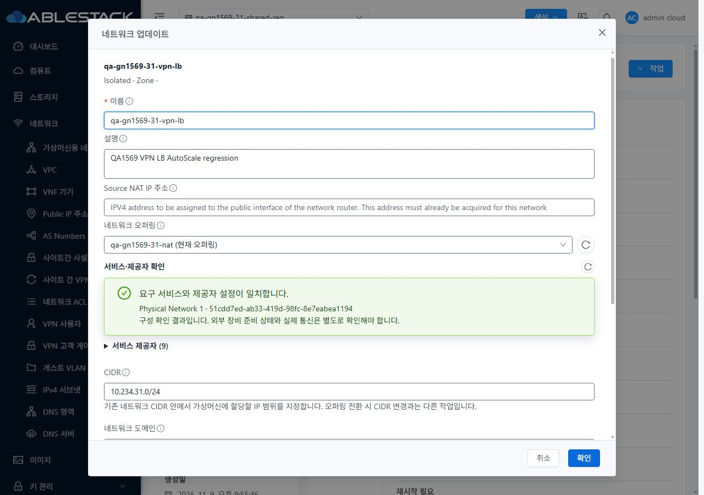
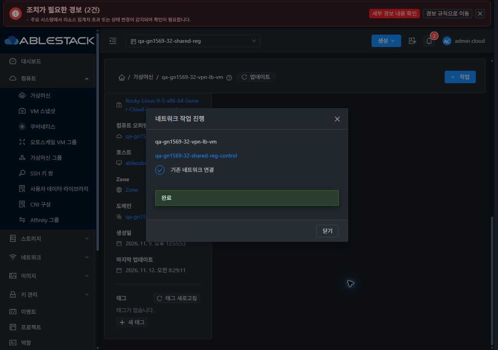
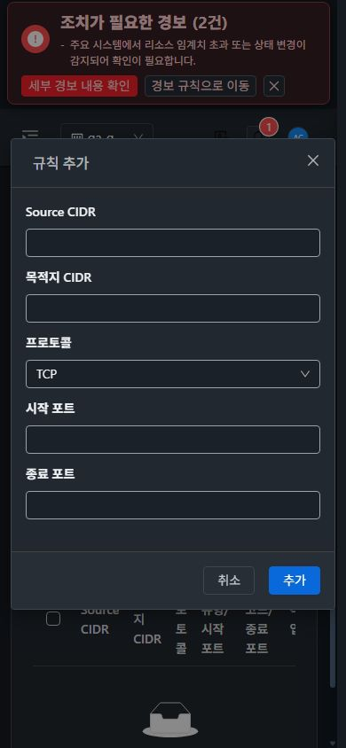
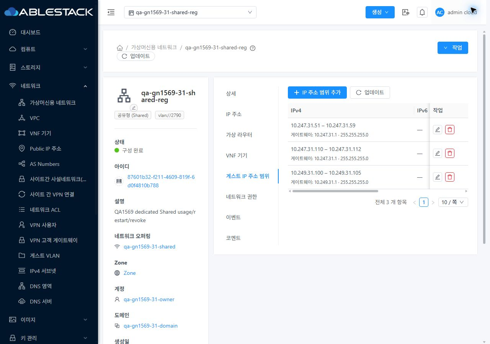

<!--
Licensed to the Apache Software Foundation (ASF) under one
or more contributor license agreements.  See the NOTICE file
distributed with this work for additional information
regarding copyright ownership.  The ASF licenses this file
to you under the Apache License, Version 2.0 (the
"License"); you may not use this file except in compliance
with the License.  You may obtain a copy of the License at

  http://www.apache.org/licenses/LICENSE-2.0

Unless required by applicable law or agreed to in writing,
software distributed under the License is distributed on an
"AS IS" BASIS, WITHOUT WARRANTIES OR CONDITIONS OF ANY
KIND, either express or implied.  See the License for the
specific language governing permissions and limitations
under the License.
 -->

# 원본 캡처와 검증 화면

캡처는 배포한 app.9e630348.js를 실제 Chrome에서 조작해 저장한 원본 JPEG다. 중복 재촬영은 마지막 프레임으로 정리하고, 프로젝트/화면 전환 중 문맥이 맞지 않던 2개 프레임은 공개 자료에서 제외했다. [이미지 무결성](evidence/capture-integrity.json)은 실제 파일 크기와 기록한 viewport×DPR을 대조한다. 1600 확대 캡처 중 2장은 DOM viewport 1600×1000에 대해 반환된 원본 이미지 높이가 726이다. 해당 2장은 전체 viewport 캡처로 판정하지 않고 보이는 영역만 보존했다.

| 클러스터 | 화면 | 원본 크기 / DOM viewport | 테마 | 원본 |
| --- | --- | --- | --- | --- |
| 31 | 31-isolated-detail-1280-light | 1280×900 / 1280×900 | 라이트 | [캡처](screenshots/31-isolated-detail-1280-light.jpg) |
| 31 | 31-network-update-1280-light | 1280×900 / 1280×900 | 라이트 | [캡처](screenshots/31-network-update-1280-light.jpg) |
| 31 | 31-ui-update-job-success-1280-light | 1280×900 / 1280×900 | 라이트 | [캡처](screenshots/31-ui-update-job-success-1280-light.jpg) |
| 31 | 31-egress-toolbar-1280-light | 1280×900 / 1280×900 | 라이트 | [캡처](screenshots/31-egress-toolbar-1280-light.jpg) |
| 31 | 31-egress-rule-dialog-1280-light | 1280×900 / 1280×900 | 라이트 | [캡처](screenshots/31-egress-rule-dialog-1280-light.jpg) |
| 31 | 31-egress-rule-dialog-390-light | 390×844 / 390×844 | 라이트 | [캡처](screenshots/31-egress-rule-dialog-390-light.jpg) |
| 31 | 31-egress-rule-dialog-390-dark | 390×844 / 390×844 | 다크 | [캡처](screenshots/31-egress-rule-dialog-390-dark.jpg) |
| 31 | 31-vm-list-standard-1280-dark | 1280×900 / 1280×900 | 다크 | [캡처](screenshots/31-vm-list-standard-1280-dark.jpg) |
| 31 | 31-vm-detail-standard-1280-dark | 1280×900 / 1280×900 | 다크 | [캡처](screenshots/31-vm-detail-standard-1280-dark.jpg) |
| 31 | 31-vm-nic-standard-1280-dark | 1280×900 / 1280×900 | 다크 | [캡처](screenshots/31-vm-nic-standard-1280-dark.jpg) |
| 31 | 31-vm-connect-dialog-1280-dark | 1280×900 / 1280×900 | 다크 | [캡처](screenshots/31-vm-connect-dialog-1280-dark.jpg) |
| 31 | 31-vm-connect-dialog-390-dark | 390×844 / 390×844 | 다크 | [캡처](screenshots/31-vm-connect-dialog-390-dark.jpg) |
| 31 | 31-nic-attach-job-success-390-dark | 390×844 / 390×844 | 다크 | [캡처](screenshots/31-nic-attach-job-success-390-dark.jpg) |
| 31 | 31-ui-nic-attached-1280-dark | 1280×900 / 1280×900 | 다크 | [캡처](screenshots/31-ui-nic-attached-1280-dark.jpg) |
| 31 | 31-nic-detach-job-success-1280-dark | 1280×900 / 1280×900 | 다크 | [캡처](screenshots/31-nic-detach-job-success-1280-dark.jpg) |
| 31 | 31-vm-nic-standard-768-dark | 768×900 / 768×900 | 다크 | [캡처](screenshots/31-vm-nic-standard-768-dark.jpg) |
| 31 | 31-vm-scroll-1600-dark | 1600×900 / 1600×900 | 다크 | [캡처](screenshots/31-vm-scroll-1600-dark.jpg) |
| 31 | 31-vm-reload-scroll-1600-dark | 1600×900 / 1600×900 | 다크 | [캡처](screenshots/31-vm-reload-scroll-1600-dark.jpg) |
| 31 | 31-shared-detail-1280-dark | 1280×900 / 1280×900 | 다크 | [캡처](screenshots/31-shared-detail-1280-dark.jpg) |
| 32 | 32-isolated-detail-1280-light | 1280×900 / 1280×900 | 라이트 | [캡처](screenshots/32-isolated-detail-1280-light.jpg) |
| 31 | 31-shared-ip-addresses-1280-dark | 1280×900 / 1280×900 | 다크 | [캡처](screenshots/31-shared-ip-addresses-1280-dark.jpg) |
| 32 | 32-network-update-1280-light | 1280×900 / 1280×900 | 라이트 | [캡처](screenshots/32-network-update-1280-light.jpg) |
| 31 | 31-shared-ip-ranges-1280-dark | 1280×900 / 1280×900 | 다크 | [캡처](screenshots/31-shared-ip-ranges-1280-dark.jpg) |
| 32 | 32-ui-update-job-success-1280-light | 1280×900 / 1280×900 | 라이트 | [캡처](screenshots/32-ui-update-job-success-1280-light.jpg) |
| 32 | 32-egress-rule-dialog-1280-light | 1280×900 / 1280×900 | 라이트 | [캡처](screenshots/32-egress-rule-dialog-1280-light.jpg) |
| 32 | 32-egress-rule-dialog-390-light | 390×844 / 390×844 | 라이트 | [캡처](screenshots/32-egress-rule-dialog-390-light.jpg) |
| 32 | 32-egress-rule-dialog-390-dark | 390×844 / 390×844 | 다크 | [캡처](screenshots/32-egress-rule-dialog-390-dark.jpg) |
| 32 | 32-vm-list-standard-1280-dark | 1280×900 / 1280×900 | 다크 | [캡처](screenshots/32-vm-list-standard-1280-dark.jpg) |
| 32 | 32-vm-detail-standard-1280-dark | 1280×900 / 1280×900 | 다크 | [캡처](screenshots/32-vm-detail-standard-1280-dark.jpg) |
| 32 | 32-vm-connect-dialog-1280-dark | 1280×900 / 1280×900 | 다크 | [캡처](screenshots/32-vm-connect-dialog-1280-dark.jpg) |
| 32 | 32-vm-connect-dialog-390-dark | 390×844 / 390×844 | 다크 | [캡처](screenshots/32-vm-connect-dialog-390-dark.jpg) |
| 32 | 32-nic-attach-job-success-1280-dark | 1280×900 / 1280×900 | 다크 | [캡처](screenshots/32-nic-attach-job-success-1280-dark.jpg) |
| 32 | 32-ui-nic-attached-1280-dark | 1280×900 / 1280×900 | 다크 | [캡처](screenshots/32-ui-nic-attached-1280-dark.jpg) |
| 31 | 31-shared-ip-ranges-768-dark | 768×1024 / 768×1024 | 다크 | [캡처](screenshots/31-shared-ip-ranges-768-dark.jpg) |
| 32 | 32-nic-detach-job-success-768-dark | 768×1024 / 768×1024 | 다크 | [캡처](screenshots/32-nic-detach-job-success-768-dark.jpg) |
| 32 | 32-vm-nic-standard-768-dark | 768×1024 / 768×1024 | 다크 | [캡처](screenshots/32-vm-nic-standard-768-dark.jpg) |
| 32 | 32-vm-scroll-1600-dark | 1600×1000 / 1600×1000 | 다크 | [캡처](screenshots/32-vm-scroll-1600-dark.jpg) |
| 32 | 32-vm-reload-scroll-1600-dark | 1600×726 / 1600×1000 | 다크 | [캡처](screenshots/32-vm-reload-scroll-1600-dark.jpg) |
| 32 | 32-project-default-1600-dark | 1600×726 / 1600×1000 | 다크 | [캡처](screenshots/32-project-default-1600-dark.jpg) |
| 31 | 31-shared-ip-addresses-768-dark | 768×1024 / 768×1024 | 다크 | [캡처](screenshots/31-shared-ip-addresses-768-dark.jpg) |
| 32 | 32-shared-ip-addresses-1280-dark | 1280×900 / 1280×900 | 다크 | [캡처](screenshots/32-shared-ip-addresses-1280-dark.jpg) |
| 32 | 32-project-return-1280-dark | 1280×900 / 1280×900 | 다크 | [캡처](screenshots/32-project-return-1280-dark.jpg) |
| 32 | 32-shared-ip-ranges-1280-dark | 1280×900 / 1280×900 | 다크 | [캡처](screenshots/32-shared-ip-ranges-1280-dark.jpg) |
| 32 | 32-vnf-network-association-1280-dark | 1280×900 / 1280×900 | 다크 | [캡처](screenshots/32-vnf-network-association-1280-dark.jpg) |
| 32 | 32-vnf-summary-links-1280-dark | 1280×900 / 1280×900 | 다크 | [캡처](screenshots/32-vnf-summary-links-1280-dark.jpg) |
| 32 | 32-vnf-nic-390-dark | 390×844 / 390×844 | 다크 | [캡처](screenshots/32-vnf-nic-390-dark.jpg) |
| 32 | 32-readonly-shared-ip-1280-dark | 1280×900 / 1280×900 | 다크 | [캡처](screenshots/32-readonly-shared-ip-1280-dark.jpg) |
| 32 | 32-readonly-vm-nic-1280-dark | 1280×900 / 1280×900 | 다크 | [캡처](screenshots/32-readonly-vm-nic-1280-dark.jpg) |
| 31 | 31-project-vnf-768-dark | 768×1024 / 768×1024 | 다크 | [캡처](screenshots/31-project-vnf-768-dark.jpg) |
| 31 | 31-vnf-nic-768-dark | 768×1024 / 768×1024 | 다크 | [캡처](screenshots/31-vnf-nic-768-dark.jpg) |
| 31 | 31-vnf-nic-390-dark | 390×844 / 390×844 | 다크 | [캡처](screenshots/31-vnf-nic-390-dark.jpg) |
| 31 | 31-l2-detail-1280-dark | 1280×900 / 1280×900 | 다크 | [캡처](screenshots/31-l2-detail-1280-dark.jpg) |
| 31 | 31-readonly-shared-ip-1280-dark | 1280×900 / 1280×900 | 다크 | [캡처](screenshots/31-readonly-shared-ip-1280-dark.jpg) |
| 31 | 31-readonly-vm-nic-1280-dark | 1280×900 / 1280×900 | 다크 | [캡처](screenshots/31-readonly-vm-nic-1280-dark.jpg) |
| 31 | 31-final-review-shared-1280-light | 1280×900 / 1280×900 | 라이트 | [캡처](screenshots/31-final-review-shared-1280-light.jpg) |
| 32 | 32-final-review-shared-1280-light | 1280×900 / 1280×900 | 라이트 | [캡처](screenshots/32-final-review-shared-1280-light.jpg) |

합계 56개. VM 목록의 빈 선택 항목 링크·모바일 표 헤더의 P3 표시 후보는 원본에 보존했다. 32 관리자 화면 상단의 경보는 기존 환경 경보이며 오류로 새 등록하지 않았다.

