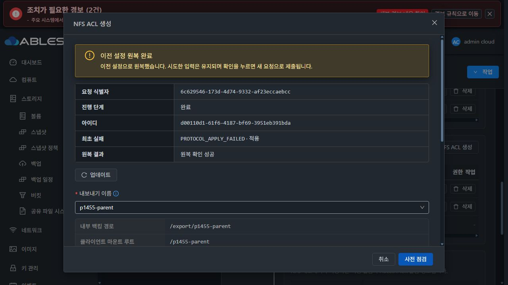

# #1455 구현·13번 배포·실제 UI 검증 중단 보고

**완료 아님 / 이슈 OPEN / Epic PR Draft 유지.** 구현 commit은 `4065598a3f058149cf9e04d0671eca8322789182`입니다. 첫 예상하지 않은 제품 오류에서 기능 시험을 중단했고 이후 재시도·ACL 확장·추가 구현·추가 배포를 하지 않았습니다. 이후 작업은 읽기 전용 원인 분석과 증거·이슈·PR 기록뿐입니다.

## 구현과 배포

- 상대 경로·flat alias 분리, FD·UUID·inode·mount ID 검증, NFS/SMB 서비스 루트 bind 고정, 생성 영수증의 SQL 확정, 빈 디렉터리만 정리하는 실패 보상, 부모 삭제/retarget 및 detach 보호를 연결했습니다.
- 기존 relativepath 미지정 요청과 SMB 단순 옵션 reload는 유지합니다. 공통 Volume API와 DB 스키마·host agent는 변경하지 않았습니다.
- 관리 모듈/게스트/UI 빌드 완료. 서명 `1455.paths.1` 및 baseline8을 기존 SystemVM에 반영했습니다.
- 관리 JAR는 18개 항목 후보 중 실제 15개만 변경됐고 나머지 92,539개는 바이트 비교로 확인했습니다. 관리 서비스는 `mold.service`입니다.
- UI는 기존 배포 소스 기준의 임시 export에 SharedFS 변경만 반영해 빌드했으며 자산7개만 배포했습니다. 운영 `config.json`과 실제 theme의 `color.less`는 보존했습니다. 실제 root는 `/usr/share/cloudstack-management/webapp`이며 Mold 경로의 부모가 이 경로로 연결됩니다.
- 새 SystemVM QCOW2 이미지도 서명/manifest/profile/파일10개, qemu-img, bzip2 검증을 통과했습니다. 제품 오류 발생 후 이미지 업로드·템플릿 등록은 진행하지 않았습니다.

## 배포 전 검증

게스트80 PASS, 관리/API/실제 coordinator→전용 strict MariaDB DAO9 PASS(0 SKIP), 신규 UI 요청·표시 계약7 PASS, UI lint PASS. 실제 SystemVM 주입8 PASS와 서명 이미지 최초·반복 bootstrap3회 PASS, 이전 helper로의 downgrade 차단 PASS입니다. 주입 시험은 전용 임시 디렉터리·private mount namespace만 사용해 정리했으며 실제 UI/클라이언트 인수를 대체하지 않습니다.

## 실제 UI에서 확인한 결과

- 잘못된 `../outside` 상대 경로는 UI에서 API 제출 전 차단됐습니다.
- 없는 디렉터리에 생성 옵션을 명시하지 않으면 `DIRECTORY_CREATION_REQUIRED`로 사전 점검이 차단됐습니다.
- 생성 옵션을 명시해 NFS `p1455-parent`를 실제 UI에서 생성했고 COMMITTED를 확인했습니다.
- 서비스 `c1eca707-a554-4c42-85cd-1e9e9744d804`, DATA `e070a0aa-dbf5-48c0-83e0-09f874446277`는 10GiB SPARSE XFS입니다.
- 실제 경로는 DATA의 `epic1455/projects`, 외부 alias는 `/export/p1455-parent`입니다. 생성된 공유 UUID `9cc9628a-8a5a-4172-a92b-46d78f0610cf`, inode152/root inode128, UID/GID65534:65534, mode0775입니다.
- 이어서 UI에서 두 클라이언트 `10.10.254.224/32`, `10.10.254.223/32`만 허용하는 ACL을 적용했으나 실패했습니다. 작업 `d00110d1-61f6-4187-bf69-3951eb391bda`, 요청 `6c629546-173d-4d74-9332-af23eccaebcc`, API530, `PROTOCOL_APPLY_FAILED`, 최종 `ROLLED_BACK`/`SUCCEEDED`입니다.
- 새 시험 NFS 공유는 생성된 상태로 진단을 위해 남겼고 실패한 명시 ACL은 저장되지 않았습니다. 원복 기준은 ACL 적용 전의 기본 허용 설정입니다. 다른 신규 시험 자원은 만들지 않았습니다.

## 하위 실패 원인과 확인 방법

현재 활성 CLI의 `probe_nfs_export_visibility`는 Ganesha를 시작한 다음, **ACL에 포함된 SystemVM 로컬 IPv4 주소**를 선택해 자기 자신으로 mount 점검을 합니다. SystemVM의 로컬 global IPv4는 `10.10.13.220` 하나입니다. 이번 두 /32에 이 주소가 포함되지 않으므로 아래 오류를 만들고 mount 전에 probe 실패로 판단합니다.

`no local IPv4 address is allowed by export clients: 10.10.254.224/32, 10.10.254.223/32`

이후 endpoint를 정지하고 예외를 발생시키므로 coordinator가 원복합니다. 경로 UUID/inode/bind 신원 검사 실패나 네트워크 패킷 손실로 확인된 문제가 아닙니다. 이 selector는 이번 구현 전 코드와 SHA256이 같습니다(`510cdf56220ab405e22499ab3abf27f454f962b6b50e27c4e25e6e71a54db263`). 기존 시험의 `10.10.0.0/16`은 서버 IP도 포함하지만 이번 원격 클라이언트 한정 ACL은 포함하지 않는 차이가 있습니다.

정확한 활성 함수를 추출해 **ip 주소 조회만 허용하는 읽기 전용 진단**을 실행했고 동일 host-selection 실패를 확인했습니다. mount·서비스·ACL·구성 적용 명령0개이며 실패한 기능 작업을 재실행한 것이 아닙니다. 최초 자식 프로세스 stderr는 현재 wrapper가 영구 저장하지 않고, `runner-result.json`은 원복 실행 결과로 교체되므로 원래 traceback 원문은 남아 있지 않습니다. 원복 후 성공 결과를 최초 적용 성공의 증거로 쓰지 않았습니다.

## 영향과 미완료 범위

원복 후 기존54개 객체의 파일 내용 hash·UID/GID·mode·ACL·inode·device를 전부 비교해 이전과 일치함을 확인했습니다. 기본 smbd는 inactive이며 MAC·IP·디스크 포맷을 변경하지 않았습니다. 원복 실행의 NFS 세 공유 점검은 정상입니다. 새 시험 공유 이외 기존 구성/데이터를 정리·삭제하지 않았습니다.

SMB 중첩 공유, 두 실제 클라이언트 접속, 부모 삭제/detach 차단, 의도한 실패 원복, VM/관리 서버 재시작 후 인수는 아직 완료하지 않았습니다. 생성 직후 목록의 UNAVAILABLE 관측 표시(지연 여부 미확인) 및 성공 상태의 NOT_NEEDED 원복 표시 문구는 표시 차이로 기록하며 #1468 UI 정리 대상으로 남깁니다.

## 개선 방향 — 아직 구현하지 않음

1. 원격 클라이언트만 허용한 정상 ACL과 로컬 probe 불가능을 구분합니다. 서버 자체 IP를 ACL에 추가하는 우회는 하지 않습니다.
2. 로컬 주소가 ACL에 없으면 local mount 점검을 `NOT_APPLICABLE_LOCAL_ACL`/외부 클라이언트 확인 필요로 구분하고, 렌더링·바인딩 신원·리스너·실제 export 등록 검증과 분리합니다. ACL에 허용된 로컬 주소가 있는 경우의 실제 mount 실패 및 구성/신원/리스너 오류는 계속 실패로 처리합니다.
3. UI에는 적용 결과와 외부 접근 검증 여부를 구분해서 표시합니다. 최종 기능 인수는 허용된 두 클라이언트에서 실제 접속·쓰기·데이터 보존으로 확인합니다.
4. 최초 runner 실패의 안전한 세부 코드를 원복 전에 보존해, 원복 성공 결과로 덮이지 않도록 합니다.
5. 두 원격 /32·서버 포함 CIDR·다중 export·bind 경로를 포함한 실제 함수/entrypoint 및 SystemVM 주입 회귀 후, 동일 UI 절차를 다시 검증합니다.

사용자의 다음 지시 전까지 위 수정과 기능 검증은 진행하지 않습니다.
