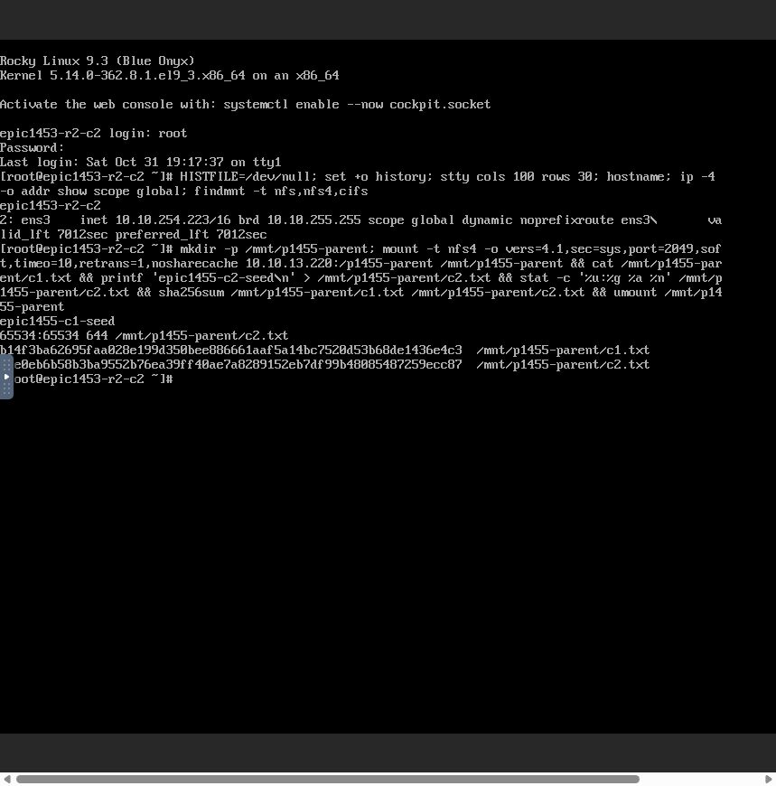
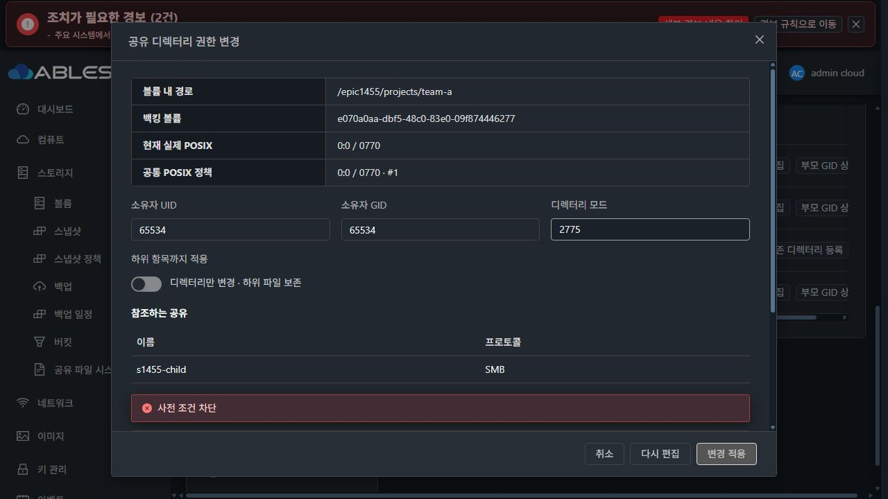

# #1455 R2 — NFS 자체 점검 해결 및 다음 사전 점검 차단 보고

**#1455 완료 아님 / OPEN / Epic PR #1470 Draft 유지.** 구현 `82d83b6c2c0477b30c6fb5a5865c57f105b2d088`. NFS 자체 점검 결함은 ACL 확장 없이 수정해 실제 UI와 두 클라이언트로 통과했습니다. 이어진 SMB 초기 구성의 setgid 사전 점검 차단에서 작업을 중단했습니다. 이후 재적용·설정 변경·추가 배포는 하지 않았고 읽기 전용 진단 및 증거 기록과 클라이언트 인증정보 정리만 했습니다.

## NFS 수정과 보호

숫자 IP/CIDR 정책이 로컬 서버를 제외하면 `EXTERNAL_CLIENT_REQUIRED`로 구분합니다. 실제 mount 결과는 확인되지 않았다고 표시하며 성공으로 꾸미지 않습니다. 서버 IP·loopback·대역을 ACL에 추가하지 않습니다.

로컬 IP 관측 실패, 해석할 수 없는 정책, 허용된 로컬 주소의 mount 실패, 다른 export/포트 실패는 계속 실패입니다. 기존 UUID·inode·경로·mount 경계와 리스너 검증은 유지합니다. 최초 구조화된 NFS runner 실패는 원복 전에 보존해 이후 결과로 덮이지 않게 했습니다.

API에는 정책과 분리된 포트별 localprobe 관측을 추가했고 NFS 탭에는 허용 클라이언트 확인 안내 컴포넌트를 추가했습니다. **UI 모듈 빌드는 완료됐지만 새 안내의 배포와 실조회 반영 검증 전에 중단했습니다. 실제 목록 응답에서도 새 localprobe 필드 반영은 아직 확인하지 못했으므로 표시 인수 완료로 계산하지 않습니다.**

## 빌드·사전 실증·배포

- guest 회귀87 PASS, Java/API17 PASS, 실제 ApiResponseSerializer 출력을 이용한 신규 안내2+경로UI7 PASS, lint PASS.
- 실제 SystemVM 격리 주입4 PASS: 두 포트 실제 mount 검증, 원격 전용 ACL 무변경, 제외된 서버의 실제 접속 거부, 다른 포트 mount 실패 유지. 운영 불변·임시 정리 확인.
- 처음 native harness가 NFSv4의 제외된 export를 ENOENT로 숨기는 응답을 너무 좁게 판정해 시험 단언만 교정했습니다. 제품 코드나 접근 권한을 바꾼 것이 아닙니다.
- 최종 서명1455.paths.2/baseline8의 최초·반복 bootstrap3회 PASS, 관리 파일10개·서명·profile 일치 확인.
- 13번 기존 SystemVM 모듈과 관리 모듈 배포 완료. 관리 JAR5개 항목만 변경했고 나머지92,550개는 바이트 일치입니다. DB 스키마·host agent 변경 없음.
- UI 빌드와 SystemVM QCOW2/bzip2/서명 이미지 빌드는 완료했지만 새 UI 자산 배포·새 이미지 업로드/템플릿 등록은 중단 후 하지 않았습니다.

## 실제 UI와 클라이언트 통과 결과

1. 이전과 같은 두 주소 `10.10.254.224/32`, `10.10.254.223/32`를 UI에서 p1455-parent ACL에 적용해 **COMMITTED**, revision28을 확인했습니다. 작업 `52354c5b-6d4e-4bf8-830a-55574ebc2f2e`, 요청 `65e4b9ed-0062-4a78-8c6f-d1e37f250241`입니다. 서버 주소는 추가하지 않았습니다.
2. 두 실제 Mold noVNC 클라이언트에서 NFS mount·쓰기·교차 읽기·hash를 확인했습니다. c1.txt는 `b14f3ba62695faa028e199d350bee886661aaf5a14bc7520d53b68de1436e4c3`, c2.txt는 `4ce0eb6b58b3ba9552b76ea39ff40ae7a8289152eb7df99b48085487259ecc87`, UID/GID65534:65534, mode0644입니다.
3. NFS 부모 `epic1455/projects` 아래 SMB `s1455-child`의 `epic1455/projects/team-a`를 실제 UI에서 생성해 **COMMITTED**, revision29를 확인했습니다. 작업 `acc9671e-40f1-448e-b304-26984aa968d2`입니다. 부모 접근 영향 안내도 UI에서 확인했습니다.
4. ACL 전에는 SMB 공유를 게시하지 않는 보호가 작동했고, 기존 인증 계정의 실제 tree connect가 `NT_STATUS_BAD_NETWORK_NAME`으로 거부됐습니다. 의도한 접근 거부이며 제품 장애로 판정하지 않았습니다.
5. 같은 UI의 공유 디렉터리 탭에서 현재 실제 값 **0:0 / 0770**을 공통 정책으로 채택해 **COMMITTED**, revision30을 확인했습니다. 작업 `14bdce65-3f73-4005-b46f-71835c60eec8`, 정책 `ae3942e2-aa6a-3a88-ac1f-878c69d3ea31` revision1입니다. 채택은 파일과 권한을 바꾸지 않았습니다.



## 새 차단: 미게시 SMB의 setgid 점검

새 하위 디렉터리만 65534:65534/2775로 바꾸는 사전 점검에서 **BLOCKED / DIRECTORY_RUNTIME_COMMAND_FAILED**가 표시됐습니다. 시각은2026-11-01 01:37:44 KST, 구성 revision30이며 실제 권한 변경 작업은 제출하지 않았습니다.

하위 원인은 실제 활성 helper의 `DirectoryPolicies.prepare`가 setgid를 켤 때 `smb_runtime_settings`를 호출하고, 다음 명령이 실행 중인 리스너 설정에 해당 공유 섹션이 있다고 가정하는 것입니다.

```text
testparm -s --section-name=s1455-child --parameter-name=inherit owner
  /etc/ablestack-storage/smb-listeners/4f04f7ac-0330-4a9d-b9b7-7c37a3010e46-1a562f59f9fe.conf
exit 1: Unknown section s1455-child
```

SMB 공유는 ACL0개·guestOk=false여서 앞서 확인한 보호에 따라 아직 게시되지 않았습니다. 설정 파일 자체는 testparm에서 정상 로드됐지만 미게시 섹션 조회가 실패한 것입니다. NFS 자체 점검의 재발이나 네트워크 손실로 확인된 문제가 아닙니다. 진단은 활성 함수를 읽기 전용 testparm만 허용해 호출했으며 설정/서비스/권한 명령을 실행하지 않았습니다.

사전 점검 입력의 setgid2775는 저장되지 않았습니다. 실제 child는 UID/GID0:0, mode0770, inode25165961, 빈 디렉터리를 유지합니다. **미게시 상태의 준비 순서 문제도 관련돼 있으므로, 공개된 서비스 누락과 의도된 미게시를 구분하지 않은 채 무조건 예외를 무시하거나 권한을 풀어서는 안 됩니다.**



## 영향·남은 일·재개 방향

기존54객체의 hash·UID/GID·mode·ACL·inode·device 전부 이전과 같습니다. DATA는10GiB SPARSE XFS, FS UUID `9c8ddfe9-3e23-46f0-9476-5c794b004841`이며 MAC/IP/포맷을 바꾸지 않았습니다. 두 클라이언트의 NFS 마운트는 해제했고 런타임 SMB 암호 환경변수 제거·로그아웃을 마쳤습니다.

미완료는 SMB ACL 게시와 실제 교차 접근, 형제/동일 경로 alias, 부모 삭제/retarget와 detach의 실제 UI 보호, 의도한 실패 보상, 실제 VM/관리 재시작 인수 및 새 안내 UI 배포입니다. 인수4항목은 미체크로 유지합니다.

재개 방향은 UI에서 ACL 설정 대기/미게시 상태와 실행 중 설정 누락을 명확히 구분하고, setgid 검사의 실행 전제 및 준비 순서를 안내하는 것입니다. 먼저 ACL로 게시한 뒤 상속/권한을 검증하는 순서도 검토 대상입니다. 미게시 상태에서도 정책 변경을 허용할 경우에는 저장 설정과 전체 리스너의 의도된 섹션 부재가 확인된 경우만 분리해야 하며, 게시된 공유의 섹션 누락·force user/group 충돌·신원 오류는 계속 차단해야 합니다. 이번 중단 후 어느 방안도 추가 구현/시험하지 않았습니다.
